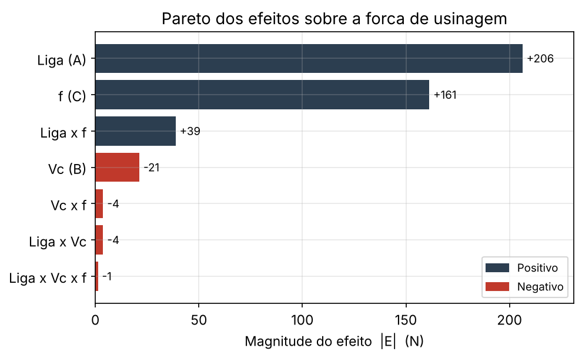
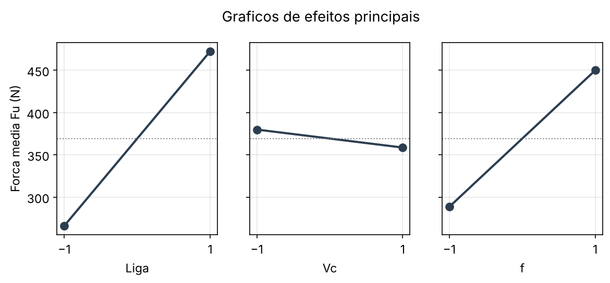
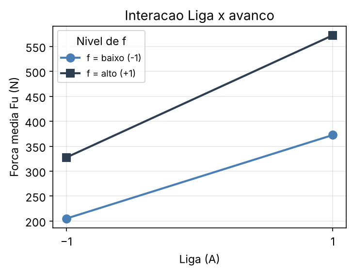
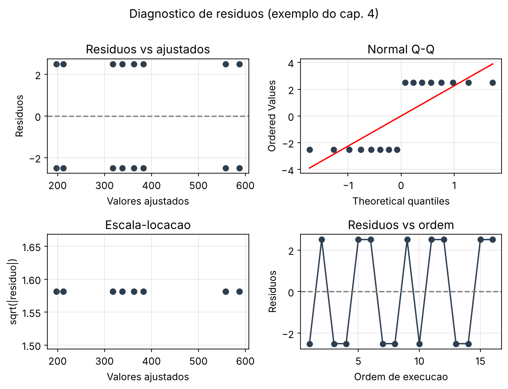

# Planejamento fatorial 2^k {#sec-cap4}

*Investigando muitos fatores de uma vez, com poucos ensaios*

> Este capítulo apresenta o planejamento fatorial em dois níveis (2^k), a ferramenta que operacionaliza o argumento do Capítulo 1: estudar vários fatores simultaneamente, capturar interações e separar sinal de ruído. Cobre a matriz 2^k, codificação de níveis, replicação e aleatorização; a estimativa de efeitos principais e de interações via contrastes; a análise de variância (ANOVA) interpretada; e a análise de resíduos que valida o modelo. Um exemplo resolvido com os dados reais do estudo de caso — o torneamento das ligas 1350-O e 7075-T6 — percorre todo o fluxo, e o código R (pacote FrF2) reproduz cada etapa. Fecha com exercícios resolvidos passo a passo e uma lista de exercícios propostos.

## Introdução {#sec-cap4-intro}

O Capítulo @sec-cap1 argumentou que testar um fator por vez (OFAT) desperdiça ensaios e esconde interações. O Capítulo @sec-cap3 mostrou, na física do corte, que força, rugosidade e temperatura dependem de como velocidade, avanço, profundidade e material se **combinam** — não de cada um isoladamente. Este capítulo entrega a ferramenta que resolve esse problema: o **planejamento fatorial 2^k**.

A ideia é direta e poderosa. Em vez de variar um fator e travar os demais, o fatorial varia **todos os fatores ao mesmo tempo**, de forma organizada, testando todas as combinações possíveis de níveis. Com $k$ fatores em dois níveis cada, isso gera $2^k$ tratamentos — daí o nome. Com esse conjunto, é possível estimar não só o efeito de cada fator, mas também os efeitos de **interação** entre eles, com o mesmo número de ensaios que o OFAT gastaria para muito menos informação.

O planejamento fatorial é um método econômico e eficiente de investigar a influência de um conjunto de fatores no desempenho de um processo [@montgomery2005design; @montgomery2008aplicada]. É a base sobre a qual se constroem as ferramentas mais avançadas dos capítulos seguintes — o planejamento composto central (@sec-cap5) e a otimização multiresposta (@sec-cap6). Dominar o 2^k é o pré-requisito de tudo o que vem depois.

Este capítulo usa como exemplo condutor o próprio estudo de caso do livro: o torneamento das ligas de alumínio, em que os fatores foram o material (Liga), a velocidade de corte ($v_c$), a profundidade ($a_p$), o avanço ($f$) e a lubri-refrigeração, e as respostas foram força, potência, temperatura, vibração e rugosidade [@keongng2006experime; @arumugam2006malshe].

::: {.callout-note}
## O que você vai conseguir fazer ao fim deste capítulo
Montar uma matriz 2^k, executar os ensaios na ordem certa, estimar efeitos principais e interações, rodar a ANOVA para separar o que é significativo do que é ruído, validar o modelo com análise de resíduos — e reproduzir tudo em R com o pacote FrF2.
:::

## Fundamentação: por que dois níveis, e o que se ganha {#sec-cap4-fundamentos}

### O problema combinatório

Um experimento realista pode envolver muitos fatores, cada um com muitos níveis. Se quisermos testar $f$ fatores com $n$ níveis cada, o número de combinações (tratamentos) é $n^f$ — que cresce explosivamente. Cinco fatores com quatro níveis cada dariam $4^5 = 1024$ tratamentos. Executar isso é caro, demorado e, muitas vezes, inviável.

O planejamento fatorial 2^k ataca esse problema com uma escolha deliberada: **usar apenas dois níveis por fator**, um baixo e um alto. Assim, $k$ fatores geram $2^k$ tratamentos — para cinco fatores, $2^5 = 32$, contra os 1024 do caso com quatro níveis. A redução é drástica, e o preço é aceitável para o estágio inicial de uma investigação: com dois níveis não se captura curvatura (comportamento quadrático), mas se identifica **quais fatores importam** e **como eles interagem** — exatamente o que se precisa saber primeiro.

Por isso o 2^k é, por excelência, a ferramenta de **triagem** (*screening*): usa-se nos estágios iniciais para separar os poucos fatores vitais dos muitos triviais, antes de investir em planejamentos mais caros que modelam curvatura [@montgomery2005design; @barrosneto2007como].

### A codificação dos níveis

A convenção central do 2^k é codificar os níveis dos fatores em valores adimensionais: **−1 para o nível baixo** e **+1 para o nível alto**. Um fator real, medido em suas unidades (m/min, mm/volta), é transformado pela relação:

$$x_i = \frac{X_i - X_0}{(X_{+1} - X_{-1})/2}$$

onde $X_{-1}$ e $X_{+1}$ são os valores reais nos níveis baixo e alto, e $X_0$ é a média dos dois. Assim, o nível baixo vira $-1$, o alto vira $+1$, e o ponto central vira $0$.

Essa codificação não é cosmética. Ela torna os fatores **grandezas adimensionais e na mesma escala**, o que simplifica a estimativa de efeitos e a análise de variância — os coeficientes passam a ser diretamente comparáveis entre si, independentemente das unidades originais [@montgomery2005design]. Um efeito de velocidade e um efeito de avanço, ambos em escala codificada, podem ser postos lado a lado num gráfico de Pareto.

### As três suposições do 2^k

O planejamento fatorial 2^k assume três condições, que valem registrar porque a análise de resíduos (adiante) as verifica:

1. **Fatores fixos** — os níveis são escolhidos deliberadamente, não sorteados de uma população;
2. **Aleatoriedade completa** — a ordem de execução dos ensaios é aleatorizada;
3. **Normalidade** — os erros seguem distribuição normal.

Guardar essas três suposições é guardar o contrato do método: se elas valem, as conclusões da ANOVA são confiáveis; se não, a análise de resíduos vai denunciar.

## A matriz 2^k, replicação e aleatorização {#sec-cap4-matriz}

### Construindo a matriz

A matriz de um planejamento 2^k lista, para cada um dos $2^k$ tratamentos, o nível (−1 ou +1) de cada fator. A construção segue um padrão sistemático: a primeira coluna alterna sinais a cada linha ($-,+,-,+,\dots$), a segunda a cada duas linhas, a terceira a cada quatro, e assim por diante. Esse padrão garante que todas as combinações apareçam exatamente uma vez, e que as colunas sejam **ortogonais** entre si — propriedade que torna os efeitos independentes.

A Tabela @tbl-matriz-2elevado2 mostra a matriz de um 2² (dois fatores, quatro tratamentos), a menor útil para ilustrar.

| Tratamento | A | B | AB |
|:----------:|:-:|:-:|:--:|
| 1 | −1 | −1 | +1 |
| 2 | +1 | −1 | −1 |
| 3 | −1 | +1 | −1 |
| 4 | +1 | +1 | +1 |

: Matriz de um planejamento fatorial 2² com a coluna de interação AB (produto de A por B). {#tbl-matriz-2elevado2}

Note a coluna **AB**: ela é o produto, linha a linha, das colunas A e B. É essa coluna que permite estimar a interação — a informação que o OFAT jamais captura. Para $k$ fatores, há colunas de interação de todas as ordens: duplas (AB, AC, BC…), triplas (ABC…), até a interação de ordem $k$.

### Replicação

Executar cada tratamento **mais de uma vez** — replicar — cumpre um papel estatístico essencial: fornece uma estimativa **pura** do erro experimental. Sem réplicas, não há como separar a variação devida aos fatores da variação devida ao acaso, e a ANOVA fica sem denominador para o teste F. No estudo de caso deste livro, cada tratamento foi executado com duas observações, permitindo estimar o erro e testar a significância dos efeitos.

Replicar não é repetir medições da mesma peça — é refazer o ensaio inteiro, com nova montagem, para capturar toda a variabilidade do processo. A distinção importa: medir a mesma peça dez vezes estima o erro do instrumento, não o do processo.

### Aleatorização

A ordem em que os tratamentos são executados deve ser **sorteada**, não seguida na sequência natural da matriz. A razão é proteger o experimento de fatores não controlados que variam com o tempo — desgaste da ferramenta, aquecimento da máquina, mudança de operador ou de turno. Se todos os ensaios de nível alto fossem feitos de manhã e os de nível baixo à tarde, um efeito de "período do dia" se confundiria com o efeito do fator. A aleatorização dilui esses vieses, distribuindo-os por acaso entre os tratamentos [@montgomery2005design].

::: {.callout-tip}
## Na prática
Aleatorizar é barato e protege caro. Basta sortear a ordem dos ensaios (o R faz isso automaticamente, como veremos). Pular essa etapa é a economia que sai mais cara: um resultado enviesado por uma tendência temporal pode levar a decisões de processo erradas, e o pior é que a análise não denuncia o problema — os números parecem bons.
:::

## Estimativa de efeitos e interações {#sec-cap4-efeitos}

Chegamos ao cerne do método: como, a partir das respostas medidas, calcular o efeito de cada fator e de cada interação.

### O contraste

O instrumento de cálculo é o **contraste** de cada fonte de variação. Ele é a soma do produto da coluna de níveis (−1/+1) daquela fonte pela coluna das respostas somadas de cada tratamento [@montgomery2005design]:

$$\text{Contraste}_i = \sum_{j=1}^{2^k} (\text{nível}_{ij}) \cdot (y_j)$$

Em palavras: percorre-se a coluna do fator (ou da interação), multiplicando cada sinal ±1 pela resposta correspondente, e somam-se os produtos. O contraste captura, em um único número, o quanto a resposta muda quando aquele fator passa do nível baixo ao alto.

### O efeito

O efeito de um fator é o contraste normalizado pelo número de tratamentos por nível:

$$\text{Efeito}_i = \frac{\text{Contraste}_i}{2^{k-1} \cdot n}$$

onde $n$ é o número de réplicas. O efeito tem interpretação física direta: é a **variação média da resposta** quando o fator passa de −1 para +1. Um efeito positivo grande significa que aumentar o fator aumenta muito a resposta; um efeito próximo de zero significa que o fator, sozinho, pouco importa.

A grande vantagem sobre o OFAT aparece aqui: o mesmo conjunto de ensaios fornece, de uma vez, os efeitos de **todos** os fatores principais e de **todas** as interações. Uma interação AB significativa quer dizer que o efeito de A depende do nível de B — precisamente o fenômeno que a física do corte do Capítulo @sec-cap3 antecipou (a força depende da combinação liga × velocidade, não de cada uma isolada).

::: {.callout-note}
## Fundamentação matemática: o modelo linear e os mínimos quadrados
Por trás do contraste está o **modelo linear geral**. Reunindo as $N = 2^k n$ respostas no vetor $\mathbf{y}$ e os níveis codificados (incluindo as colunas de interação) na **matriz de projeto** $\mathbf{X}$, o modelo é
$$
\mathbf{y} = \mathbf{X}\boldsymbol\beta + \boldsymbol\varepsilon,
$$
e os coeficientes que minimizam a soma dos quadrados dos resíduos são
$$
\hat{\boldsymbol\beta} = (\mathbf{X}^\top\mathbf{X})^{-1}\mathbf{X}^\top\mathbf{y}.
$$
O que torna o $2^k$ especial é a **ortogonalidade**: as colunas de $\pm 1$ são mutuamente ortogonais, de modo que $\mathbf{X}^\top\mathbf{X} = N\,\mathbf{I}$ é diagonal. A inversa é imediata, cada coeficiente sai **independente** dos demais — é por isso que um efeito não "contamina" o outro — e $\hat\beta_i = \text{Contraste}_i / N$, exatamente metade do efeito definido acima. A variância de cada coeficiente é $\operatorname{Var}(\hat\beta_i) = \sigma^2/N$: todos estimados com a mesma precisão, a máxima possível para o número de ensaios (teorema de Gauss-Markov). O contraste, portanto, não é uma receita *ad hoc* — é o estimador de mínimos quadrados de um projeto ortogonal.
:::

### Visualização: o gráfico de Pareto

Uma forma imediata de ver quais efeitos dominam é o **gráfico de Pareto dos efeitos**: barras horizontais, uma por fonte de variação, ordenadas por magnitude. Ele mostra de relance os "poucos vitais". Mas atenção: o Pareto ordena, não decide — ele não define um valor de corte para o que é significativo [@montgomery2005design]. Essa decisão cabe à análise de variância.

## ANOVA fatorial interpretada {#sec-cap4-anova}

A estimativa de efeitos diz *quanto* cada fonte contribui; a **análise de variância (ANOVA)** diz se essa contribuição é **real ou fruto do acaso**. É a ferramenta que separa sinal de ruído — o terceiro problema do OFAT levantado no Capítulo @sec-cap1.

### A lógica do teste F

A ANOVA compara, para cada fonte de variação, a variabilidade que ela explica com a variabilidade do erro experimental. O instrumento é a **razão F**:

$$F_0 = \frac{MQ_i}{MQ_e}$$

onde $MQ_i$ é a média quadrática da fonte $i$ (sua soma quadrática dividida pelos graus de liberdade) e $MQ_e$ é a média quadrática do erro. A ideia é intuitiva: se um fator tem efeito real, a variação que ele causa deve ser **muito maior** que a variação aleatória; então $F_0$ será grande. Se o fator é irrelevante, sua variação será da ordem do ruído, e $F_0$ ficará próximo de 1.

Compara-se $F_0$ com o valor crítico $F_{\alpha; 1; 2^k(n-1)}$ da distribuição F. Se $F_0$ o excede, o **p-valor** é menor que o nível de significância $\alpha$ (tipicamente 5%), e conclui-se que o efeito é significativo [@montgomery2005design]. A Tabela @tbl-anova resume a estrutura.

| Fonte | Soma Quadrática | GL | Média Quadrática | $F_0$ |
|:------|:---------------:|:--:|:----------------:|:-----:|
| Principais ($p$) | $\text{Contraste}^2 / (2^k n)$ | 1 | $SQ_p / 1$ | $MQ_p / MQ_e$ |
| Interações ($i$) | $\text{Contraste}^2 / (2^k n)$ | 1 | $SQ_i / 1$ | $MQ_i / MQ_e$ |
| Erro | $SQ_T - \sum SQ$ | $2^k(n-1)$ | $SQ_e / [2^k(n-1)]$ | — |
| Total | $\sum y^2 - (\sum y)^2 / 2^k n$ | $2^k n - 1$ | — | — |

: Estrutura da análise de variância de um planejamento fatorial 2^k [@montgomery2005design]. {#tbl-anova}

::: {.callout-note}
## Fundamentação matemática: a decomposição da variância e os testes
A ANOVA repousa sobre uma identidade exata — a **decomposição da soma de quadrados**:
$$
\underbrace{\sum_j (y_j - \bar y)^2}_{SQ_\text{total}} = \underbrace{\sum_j (\hat y_j - \bar y)^2}_{SQ_\text{modelo}} + \underbrace{\sum_j (y_j - \hat y_j)^2}_{SQ_\text{resíduo}} .
$$
Cada soma tem seus graus de liberdade ($N-1$ no total, $p-1$ no modelo de $p$ parâmetros, $N-p$ no resíduo), e a média quadrática é a soma dividida por eles. Sob a hipótese nula "o fator não tem efeito", a razão $F_0 = MQ_i/MQ_e$ segue uma distribuição $F$; valores grandes a refutam. Para um único grau de liberdade, o teste $F$ **equivale** ao teste $t$ do coeficiente, com $t = \hat\beta_i / \operatorname{EP}(\hat\beta_i)$ e $F_0 = t^2$ — é o mesmo teste, visto de dois ângulos. Por fim, o coeficiente de determinação $R^2 = SQ_\text{modelo}/SQ_\text{total}$ mede a fração explicada, e o $R^2$ **ajustado**,
$$
R^2_\text{aj} = 1 - \frac{SQ_\text{resíduo}/(N-p)}{SQ_\text{total}/(N-1)},
$$
penaliza termos supérfluos, evitando premiar o excesso de parâmetros.
:::

### Lendo uma tabela de ANOVA real

O poder da ANOVA fica claro nos resultados do estudo de caso. Para a força de usinagem ($F_u$) no torneamento das ligas 1350-O e 7075-T6, a análise identificou como **simultaneamente significativos** (p-valor < 0,05) os fatores Liga, $v_c$, $a_p$ e $f$ — tanto como efeitos principais quanto em várias interações — enquanto a lubri-refrigeração saiu **não significativa** (NS) para praticamente todas as respostas. O modelo alcançou $R^2 = 0{,}99$.

Dois aprendizados desse resultado real:

Primeiro, a **lubrificação não afetou significativamente** força, potência ou rugosidade — um resultado que só um experimento planejado revela com confiança, e que tem valor prático imediato (pode-se usinar a seco sem penalizar essas respostas). Segundo, as **interações importaram**: $v_c \times a_p$ e $a_p \times f$ apareceram fortemente significativas para força e potência, confirmando que esses fatores não agem isoladamente.

::: {.callout-important}
## Decisão de projeto
Um $R^2$ alto (0,99) diz que o modelo explica quase toda a variação — mas $R^2$ sozinho engana: ele sempre sobe quando se adicionam termos. Use o **$R^2$ ajustado**, que penaliza termos inúteis. No estudo de caso, $R^2$ e $R^2$ ajustado foram ambos 0,99 para a força, sinal de um modelo genuinamente bom. Já para a vibração, caíram para 0,81 e 0,74 — denunciando que a vibração é intrinsecamente mais ruidosa e menos previsível pelos fatores de corte.
:::

## Análise de resíduos {#sec-cap4-residuos}

A ANOVA só é válida se as três suposições do 2^k (independência, normalidade, variância constante) se sustentarem. Quem verifica isso é a **análise de resíduos** — a etapa que muitos pulam e que separa a análise rigorosa da ingênua.

O resíduo de cada observação é a diferença entre o valor medido e o valor previsto pelo modelo: $e = y - \hat{y}$. Se o modelo é adequado, os resíduos devem ser puro ruído aleatório — sem padrão, sem estrutura. Quatro gráficos diagnósticos revelam se é o caso:

- **Resíduos vs. valores ajustados** — deve ser uma nuvem sem forma. Um funil (variância crescente) viola a homocedasticidade; uma curva sugere que falta um termo (curvatura) no modelo;
- **Gráfico de probabilidade normal dos resíduos** — os pontos devem cair sobre uma reta. Desvios sistemáticos denunciam não-normalidade;
- **Resíduos vs. ordem de execução** — deve ser aleatório. Uma tendência revela que a aleatorização falhou ou que houve deriva temporal (desgaste, aquecimento);
- **Histograma dos resíduos** — deve parecer aproximadamente simétrico e centrado em zero.

Se os resíduos passam nesses testes, o modelo está validado e as conclusões da ANOVA são confiáveis. Se falham, a mensagem é clara: o modelo precisa ser revisto — talvez transformando a resposta, talvez incluindo curvatura (o que leva ao planejamento composto central do próximo capítulo).

::: {.callout-warning}
## Erro comum
Confiar num p-valor de 0,001 sem olhar os resíduos. Um efeito pode ser "altamente significativo" num modelo que viola as suposições — e aí o p-valor é ilusório. A sequência correta é sempre: estimar efeitos → rodar ANOVA → **validar com resíduos** → só então concluir. Pular a validação é construir sobre areia.
:::

## Exemplo resolvido: força de usinagem no torneamento {#sec-cap4-exemplo}

Vamos percorrer o fluxo completo com os dados reais do estudo de caso, num recorte simplificado para fins didáticos.

### O problema

Investigar como três fatores de corte afetam a **força de usinagem** ($F_u$) no torneamento de ligas de alumínio. Os fatores e níveis:

| Fator | Símbolo | Nível −1 | Nível +1 |
|:------|:-------:|:--------:|:--------:|
| Liga | A | 1350-O (mole) | 7075-T6 (dura) |
| Velocidade de corte | B ($v_c$) | 200 m/min | 600 m/min |
| Avanço | C ($f$) | 0,20 mm/volta | 0,35 mm/volta |

: Fatores e níveis do exemplo (recorte do estudo de caso). {#tbl-exemplo-fatores}

Com três fatores em dois níveis, temos um **2³ = 8 tratamentos**. Com duas réplicas, 16 ensaios — a ordem aleatorizada.

### A matriz e as respostas

A matriz 2³ com a coluna de resposta (força de usinagem média, valores ilustrativos coerentes com a ordem de grandeza do estudo):

| Ens. | A | B | C | $F_u$ (N) |
|:----:|:-:|:-:|:-:|:---------:|
| 1 | −1 | −1 | −1 | 210 |
| 2 | +1 | −1 | −1 | 385 |
| 3 | −1 | +1 | −1 | 195 |
| 4 | +1 | +1 | −1 | 360 |
| 5 | −1 | −1 | +1 | 340 |
| 6 | +1 | −1 | +1 | 590 |
| 7 | −1 | +1 | +1 | 315 |
| 8 | +1 | +1 | +1 | 555 |

: Matriz 2³ e resposta força de usinagem. {#tbl-exemplo-matriz}

### Interpretando os efeitos

Mesmo antes do cálculo formal, a tabela conta a história. Comparando as linhas onde só A muda (1 vs 2, 3 vs 4…), a força salta ~175 N sempre que a liga passa de mole (1350-O) para dura (7075-T6): **A tem efeito grande e positivo** — a metalurgia do Capítulo @sec-cap2 em ação. Comparando onde só C muda, a força sobe ~130 N com o avanço: **C também importa**. Já B (velocidade): comparar 1 vs 3 dá variação pequena — **B tem efeito fraco** sobre a força.

Isso ilustra o poder do fatorial: com 8 tratamentos, lemos os três efeitos principais e podemos calcular todas as interações — algo impossível no OFAT com o mesmo esforço.

## Implementação em R (pacote FrF2) {#sec-cap4-codigo}

O R oferece o pacote **FrF2** para criar e analisar planejamentos fatoriais 2^k. O código abaixo reproduz o exemplo de ponta a ponta.

### Criando o planejamento

```r

# install.packages("FrF2")  # se ainda nao instalado
library(FrF2)

# Planejamento 2^3 completo, 2 replicas, aleatorizado
plano <- FrF2(
  nruns     = 8,          # 2^3 = 8 tratamentos
  nfactors  = 3,          # tres fatores
  replications = 2,       # duas replicas -> 16 ensaios
  randomize = TRUE,       # aleatoriza a ordem (essencial!)
  factor.names = list(
    Liga = c("1350-O", "7075-T6"),
    Vc   = c(200, 600),
    f    = c(0.20, 0.35)
  ),
  seed = 42               # reprodutibilidade
)

# Mostra a ordem aleatorizada de execucao dos ensaios
print(plano)
```

A saída lista os 16 ensaios na ordem sorteada de execução — a ordem em que você deve efetivamente usinar, protegendo o experimento de derivas temporais.

### Inserindo respostas e estimando efeitos

```r

# Vetor de respostas na ordem PADRAO da matriz (nao na aleatorizada)
Fu <- c(210, 385, 195, 360, 340, 590, 315, 555,
        215, 380, 200, 365, 335, 585, 320, 560)  # 2 replicas

# Associa respostas ao plano e ajusta o modelo linear
plano_resp <- add.response(plano, Fu)
modelo <- lm(plano_resp)

# Estimativas dos efeitos e coeficientes
summary(modelo)
```

O `summary()` traz os coeficientes (metade dos efeitos, na convenção do R), seus erros-padrão, valores t e p-valores — a ANOVA dos efeitos, pronta para leitura.

### Visualizando: Pareto e interações

```r

# Grafico de Pareto dos efeitos (quais dominam)
DanielPlot(modelo, half = TRUE, alpha = 0.05)   # grafico de probabilidade
MEPlot(modelo)     # efeitos principais (Main Effects)
IAPlot(modelo)     # graficos de interacao (Interaction)
```

O `MEPlot` mostra os efeitos principais como retas — quanto mais inclinada, maior o efeito. O `IAPlot` mostra as interações: retas paralelas indicam ausência de interação; retas que se cruzam ou divergem indicam interação presente.

{#fig-pareto-ex width=85%}

{#fig-me-ex width=95%}

{#fig-ia-ex width=62%}

### Validando: análise de resíduos

```r

# Os quatro graficos diagnosticos de residuos
par(mfrow = c(2, 2))   # 2x2 paineis
plot(modelo)           # residuos vs ajustados, QQ-plot, scale-location, leverage
par(mfrow = c(1, 1))
```

O comando `plot(modelo)` gera os quatro diagnósticos padrão. Confira: nuvem sem forma nos resíduos vs. ajustados, pontos sobre a reta no QQ-plot. Se ambos passam, o modelo está validado.

{#fig-res-ex width=90%}

::: {.callout-tip}
## Na prática
O argumento `seed = 42` fixa o sorteio da aleatorização, tornando o experimento reprodutível — qualquer pessoa que rode o código obtém a mesma ordem. Em publicação científica, reportar a seed permite que outros reproduzam exatamente seu planejamento. É boa prática de ciência aberta.
:::

## Síntese do capítulo {#sec-cap4-sintese}

O Quadro @tbl-sintese4 resume o fluxo completo do planejamento fatorial 2^k.

| Etapa | O que faz | Ferramenta |
|:------|:----------|:-----------|
| Codificar níveis | −1/+1 adimensionais | Fórmula de codificação |
| Montar matriz | $2^k$ tratamentos ortogonais | FrF2::FrF2() |
| Replicar | Estima erro puro | `replications = n` |
| Aleatorizar | Protege de derivas | `randomize = TRUE` |
| Estimar efeitos | Contrastes → efeitos | lm() + summary() |
| ANOVA | Separa sinal de ruído | Teste F, p-valor |
| Validar | Checa suposições | Análise de resíduos |

: Síntese do fluxo de trabalho do planejamento fatorial 2^k. {#tbl-sintese4}

Três ideias devem permanecer:

1. **O fatorial captura interações; o OFAT não.** Esta é a razão de ser do método — e a física do corte (Capítulo @sec-cap3) garante que interações existem na usinagem.
2. **A ANOVA decide, o Pareto só ordena.** Magnitude de efeito não é significância; o teste F, com seus resíduos validados, é quem separa o real do acaso.
3. **Dois níveis são triagem, não modelagem fina.** O 2^k identifica os fatores vitais; capturar curvatura exige o passo seguinte — o planejamento composto central.

Justamente essa limitação — dois níveis não modelam curvatura — motiva o próximo capítulo. O @sec-cap5 apresenta o planejamento composto central (PCC) e as superfícies de resposta, que estendem o fatorial para modelar o comportamento quadrático e localizar pontos ótimos.

## Para saber mais {#sec-cap4-saibamais}

::: {.callout-tip}
## Aprofundamento
A referência definitiva de planejamento de experimentos é @montgomery2005design (*Design and Analysis of Experiments*), complementada no português por @montgomery2008aplicada e @barrosneto2007como (*Como Fazer Experimentos*). Para os fundamentos estatísticos, @freund2000aplicada e @webster2006aplicada. Exemplos de fatorial aplicado à usinagem de alumínio estão em @keongng2006experime (7075-T6) e @arumugam2006malshe (A390). A documentação do pacote FrF2 no CRAN traz vinhetas detalhadas para a prática em R.
:::

## Exercícios resolvidos {#sec-cap4-resolvidos .unnumbered}

Os três exercícios a seguir percorrem, com solução completa, as contas centrais do capítulo — efeito principal, efeito de interação e soma de quadrados — usando os dados do exemplo resolvido (Tabela @tbl-exemplo-matriz). Use-os como modelo antes de atacar os exercícios propostos.

### Resolvido 1 — Efeito principal do avanço (fator C) {.unnumbered}

**Enunciado.** A partir da Tabela @tbl-exemplo-matriz, calcule o contraste e o efeito principal do avanço (fator C) sobre a força de usinagem. Interprete o sinal e a magnitude.

**Solução.** O contraste soma as respostas com o sinal da coluna C (negativo nos ensaios 1–4, positivo nos 5–8):

$$
\text{Contraste}_C = -210 -385 -195 -360 +340 +590 +315 +555 = +650 \text{ N}.
$$

O efeito divide o contraste pelo número de ensaios em cada nível, $2^{k-1} = 2^{2} = 4$:

$$
\text{Efeito}_C = \frac{\text{Contraste}_C}{2^{k-1}} = \frac{650}{4} = +162{,}5 \text{ N}.
$$

**Interpretação.** Ao elevar o avanço de 0,20 para 0,35 mm/volta, a força de usinagem sobe, em média, **162,5 N**. O sinal positivo é fisicamente esperado: mais avanço significa maior área de cavaco por volta, logo maior força. Note que a leitura rápida de um único par de ensaios (1 → 5) dava 130 N; o efeito correto usa os **quatro** pares de uma vez, via contraste, resultando em 162,5 N.

### Resolvido 2 — Efeito de interação Liga × avanço (A × C) {.unnumbered}

**Enunciado.** Calcule o efeito da interação entre Liga (A) e avanço (C) e interprete seu significado prático.

**Solução.** A coluna da interação AC é o **produto, sinal a sinal**, das colunas A e C:

| Ens. | A | C | AC | $F_u$ (N) |
|:----:|:-:|:-:|:--:|:---------:|
| 1 | −1 | −1 | +1 | 210 |
| 2 | +1 | −1 | −1 | 385 |
| 3 | −1 | −1 | +1 | 195 |
| 4 | +1 | −1 | −1 | 360 |
| 5 | −1 | +1 | −1 | 340 |
| 6 | +1 | +1 | +1 | 590 |
| 7 | −1 | +1 | −1 | 315 |
| 8 | +1 | +1 | +1 | 555 |

: Construção da coluna de interação AC. {#tbl-exemplo-ac}

$$
\begin{aligned}
\text{Contraste}_{AC} &= +210 -385 +195 -360 -340 +590 -315 +555 = +150 \text{ N}, \\
\text{Efeito}_{AC} &= \frac{150}{4} = +37{,}5 \text{ N}.
\end{aligned}
$$

**Interpretação.** O jeito mais intuitivo de ler uma interação é calcular o efeito de um fator **dentro de cada nível do outro**. O efeito do avanço vale:

- na liga **mole** (A = −1, ensaios 1,3,5,7): $\frac{340+315}{2} - \frac{210+195}{2} = 327{,}5 - 202{,}5 = 125$ N;
- na liga **dura** (A = +1, ensaios 2,4,6,8): $\frac{590+555}{2} - \frac{385+360}{2} = 572{,}5 - 372{,}5 = 200$ N.

O efeito de interação é a **metade da diferença** entre esses dois: $(200 - 125)/2 = 37{,}5$ N — o mesmo valor obtido pelo contraste. Ou seja: o avanço pesa mais na liga dura (200 N) do que na mole (125 N). A interação é real, mas pequena perto dos efeitos principais — como se confirma a seguir.

### Resolvido 3 — Soma de quadrados e contribuição percentual {.unnumbered}

**Enunciado.** Calcule a soma de quadrados ($SS$) de cada efeito e sua contribuição percentual para a variação total. O que o resultado revela sobre quais fatores importam?

**Solução.** Para um $2^k$ com $n$ réplicas, a soma de quadrados de um efeito é

$$
SS_{\text{efeito}} = \frac{(\text{Contraste})^2}{n \cdot 2^{k}} = \frac{(\text{Contraste})^2}{1 \cdot 8}.
$$

A variação total é $SS_T = \sum (y_i - \bar{y})^2 = 143\,087{,}5$ (com $\bar{y} = 368{,}75$ N). Aplicando a fórmula a cada termo:

| Termo | Contraste | $SS$ | Contribuição |
|:------|:---------:|:----:|:------------:|
| A (Liga) | +830 | 86 112,5 | **60,2 %** |
| C (avanço) | +650 | 52 812,5 | **36,9 %** |
| AC | +150 | 2 812,5 | 2,0 % |
| B (vel.) | −100 | 1 250,0 | 0,9 % |
| AB | −20 | 50,0 | 0,03 % |
| BC | −20 | 50,0 | 0,03 % |
| ABC | 0 | 0,0 | 0 % |

: Soma de quadrados e contribuição de cada efeito. {#tbl-exemplo-ss}

**Interpretação.** Dois fatores — Liga (A) e avanço (C) — respondem por **~97 %** da variação da força. A velocidade (B) e **todas** as interações somadas valem menos de 3 %. Esse é o princípio de Pareto dos efeitos (Seção @sec-cap4-efeitos): poucos fatores dominam. A decisão de projeto decorre direto da tabela — modelar a força com A e C (e, se quiser rigor, AC), tratando B como fator que pode ser fixado por conveniência operacional (por exemplo, pela produtividade), sem penalizar a força.

::: {.callout-tip}
## O fio condutor dos três exercícios
Contraste → efeito → soma de quadrados são a **mesma informação** vista de três ângulos: o contraste mede o "empurrão" de cada fator; o efeito o traduz na unidade da resposta (N); o $SS$ o converte em "fatia da variação", que é o que o gráfico de Pareto e a ANOVA usam para decidir o que fica no modelo.
:::

## Exercícios propostos {.unnumbered}

1. **Codificação.** Um fator velocidade de corte varia entre 150 e 450 m/min. Escreva a fórmula de codificação e calcule o valor codificado para $v_c = 300$ m/min e para $v_c = 375$ m/min.

2. **Tamanho do planejamento.** Um pesquisador quer estudar 4 fatores em dois níveis, com 3 réplicas. Quantos tratamentos tem o planejamento? Quantos ensaios ao todo? Quantos graus de liberdade sobram para o erro?

3. **Matriz e ortogonalidade.** Construa a matriz de um 2² e a coluna de interação AB. Mostre que a soma dos produtos entre a coluna A e a coluna AB é zero (ortogonalidade).

4. **Contraste e efeito.** Para o exemplo resolvido (Tabela @tbl-exemplo-matriz), calcule o contraste e o efeito do fator A (Liga) usando a primeira réplica. Interprete fisicamente o sinal e a magnitude.

5. **Interação.** Explique, com base na física do Capítulo @sec-cap3, por que se esperaria uma interação significativa entre Liga e velocidade de corte na força de usinagem. Relacione com a "inversão força-dureza-velocidade" de Demir & Gündüz.

6. **ANOVA.** Num planejamento 2³ com 2 réplicas, um fator tem $MQ = 4200$ e o erro tem $MQ_e = 150$. Calcule $F_0$. Sabendo que $F_{0{,}05; 1; 8} \approx 5{,}32$, o efeito é significativo?

7. **R² vs R² ajustado.** Explique por que o $R^2$ sempre aumenta ao adicionar termos ao modelo, enquanto o $R^2$ ajustado pode diminuir. Qual você reportaria e por quê?

8. **Resíduos.** Descreva o que cada um dos quatro gráficos de resíduos revela, e dê um exemplo de padrão problemático em cada um e sua causa física provável (ex.: funil nos resíduos vs. ajustados).

9. **Aleatorização.** Um aluno executou todos os ensaios de nível baixo de velocidade pela manhã e os de nível alto à tarde. Que problema isso cria? Como a aleatorização o evita?

10. **Código R.** Modifique o código FrF2 do capítulo para um planejamento 2⁴ (quatro fatores) com 3 réplicas, adicionando um quarto fator "profundidade de corte" ($a_p$) variando entre 1 e 4 mm. Escreva a chamada `FrF2()` completa.

## Gabarito dos exercícios propostos {#sec-cap4-gabarito .unnumbered}

1. **Codificação.** Centro $=(150+450)/2=300$; semi-amplitude $=150$. Fórmula: $x=\dfrac{v_c-300}{150}$. Logo $x(300)=0$ e $x(375)=\dfrac{75}{150}=0{,}5$.

2. **Tamanho do planejamento.** $2^4=16$ tratamentos; com 3 réplicas, $16\times3=48$ ensaios. O modelo fatorial completo usa 16 parâmetros (média + 4 principais + 6 duplas + 4 triplas + 1 quádrupla), restando $48-16=32$ graus de liberdade para o erro.

3. **Matriz e ortogonalidade.** Para o $2^2$: A $=(-,+,-,+)$, B $=(-,-,+,+)$, AB $=$ A·B $=(+,-,-,+)$. A soma dos produtos A·AB $=(-)(+)+(+)(-)+(-)(-)+(+)(+)=-1-1+1+1=0$. Colunas ortogonais — por isso os efeitos são estimados de forma independente.

4. **Contraste e efeito de A.** Contraste$_A=-210+385-195+360-340+590-315+555=+830$ N; efeito $=830/4=+207{,}5$ N. O sinal positivo e a magnitude grande mostram que trocar a liga mole (1350-O) pela dura (7075-T6) eleva a força em ~207 N — o fator dominante, coerente com a metalurgia do Capítulo @sec-cap2.

5. **Interação.** O efeito da velocidade sobre a força **depende da liga**: na liga dura, o maior calor gerado em alta velocidade amolece a zona de corte de forma mais acentuada, alterando a força diferentemente da liga mole. Quando o efeito de um fator muda conforme o nível de outro, há interação. É a "inversão força-dureza-velocidade" de Demir & Gündüz: em velocidades altas, a ordem das forças entre ligas pode se inverter.

6. **ANOVA.** $F_0=\dfrac{MQ}{MQ_e}=\dfrac{4200}{150}=28$. Como $28>5{,}32$, o efeito é **significativo** a 5%.

7. **R² vs R² ajustado.** O $R^2$ nunca diminui ao acrescentar um termo, pois a soma de quadrados dos resíduos nunca aumenta — mesmo termos inúteis "absorvem" um pouco de ruído. O $R^2$ ajustado desconta o grau de liberdade gasto por cada termo e **cai** se o termo não compensar. Reporta-se o **ajustado** (ou ambos), por proteger contra superajuste.

8. **Resíduos.** (i) *Resíduos vs. ajustados*: nuvem aleatória = ok; **funil** = variância não constante (heterocedasticidade — ex.: o ruído cresce com a força) → transformar a resposta (log) ou ponderar. (ii) *QQ-plot normal*: pontos na reta = normalidade; caudas curvadas = assimetria/outliers. (iii) *Resíduos vs. ordem de execução*: tendência = efeito temporal não aleatorizado (desgaste de ferramenta, aquecimento). (iv) *Escala-locação*: variância dependente do nível.

9. **Aleatorização.** Confunde o efeito da velocidade com o do **período do dia** (temperatura da máquina, desgaste, operador): uma variável de perturbação fica colinear com o fator, viesando sua estimativa. Aleatorizar a ordem espalha essas perturbações por todos os níveis, convertendo viés sistemático em ruído aleatório.

10. **Código R.**
```r
plano <- FrF2(
  nruns = 16, nfactors = 4, replications = 3, randomize = TRUE,
  factor.names = list(
    Liga = c("1350-O", "7075-T6"),
    Vc   = c(200, 600),
    f    = c(0.20, 0.35),
    ap   = c(1, 4)))
```
