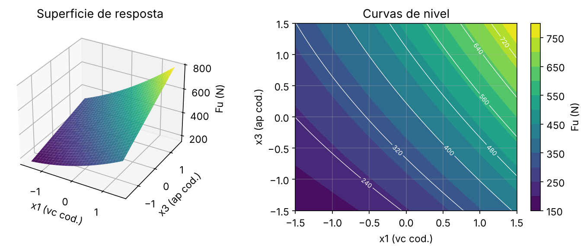

# Planejamento composto central e superfícies de resposta {#sec-cap5}

## Introdução {#sec-cap5-intro}

O Capítulo @sec-cap4 entregou o fatorial 2^k — a ferramenta de triagem que identifica quais fatores importam e como interagem. Mas terminou com uma limitação declarada: **dois níveis não capturam curvatura**. Um fatorial 2^k só "enxerga" retas; se a relação entre um fator e a resposta é curva — se existe um máximo ou mínimo no interior da faixa estudada — o 2^k passa por cima dele sem perceber.

Isso é um problema sério para quem otimiza. Na usinagem, muitas respostas têm ótimos internos: existe uma velocidade de corte que minimiza a força, um avanço que equilibra rugosidade e produtividade. Um modelo linear jamais localiza esses pontos, porque a reta não tem máximo nem mínimo no interior — ela só cresce ou só decresce.

Este capítulo resolve a limitação em dois passos. Primeiro, o **planejamento composto central (PCC)** estende a matriz fatorial com pontos que permitem estimar termos quadráticos — a curvatura. Segundo, a **metodologia de superfícies de resposta (RSM)** usa o modelo de segunda ordem resultante para mapear a resposta como uma superfície tridimensional e localizar o ótimo, com o auxílio de curvas de nível e do vetor gradiente.

O fio condutor continua sendo o estudo de caso: no torneamento das ligas de alumínio, os fatores quantitativos significativos identificados no fatorial — velocidade de corte ($v_c$), avanço ($f$) e profundidade ($a_p$) — foram levados ao PCC para modelar suas superfícies de resposta [@correia2005; @montgomery2005design].

::: {.callout-note}
## O que você vai conseguir fazer ao fim deste capítulo
Reconhecer quando o fatorial é insuficiente; construir um PCC a partir de um fatorial existente; ajustar um modelo de segunda ordem por mínimos quadrados; interpretar a superfície via curvas de nível e gradiente; e reproduzir tudo em R com o pacote rsm, incluindo visualizações 3D.
:::

## As limitações do fatorial puro {#sec-cap5-limitacoes}

### O que dois níveis não veem

Um fator estudado em apenas dois níveis (−1 e +1) fornece dois pontos. Por dois pontos passa uma única reta — e só uma reta. Não há informação para distinguir uma relação genuinamente linear de uma curva que, por acaso, passa pelos mesmos dois pontos. O modelo do fatorial 2^k, portanto, é intrinsecamente de **primeira ordem**:

$$y = \beta_0 + \sum_{i=1}^{k} \beta_i x_i + \sum_{i<j} \beta_{ij} x_i x_j + \varepsilon$$

Ele tem termos principais ($\beta_i x_i$) e de interação ($\beta_{ij} x_i x_j$), mas **nenhum termo quadrático** ($\beta_{ii} x_i^2$). É esse termo que descreve curvatura, e ele exige um terceiro nível para ser estimado — porque, geometricamente, só por três pontos se determina uma parábola.

### O ponto central como detector de curvatura

Há um truque elegante para *detectar* (ainda que não modelar) curvatura sem sair do fatorial: adicionar **réplicas no ponto central** (todos os fatores em zero). Se a média das respostas no centro difere significativamente da média dos pontos fatoriais, há curvatura — a superfície não é plana. É um teste barato: bastam algumas rodadas no centro para saber se vale a pena investir num planejamento de segunda ordem.

Mas detectar não é modelar. Uma vez confirmada a curvatura, é preciso um planejamento que a **estime** — e é aí que entra o PCC.

::: {.callout-tip}
## Na prática
Sempre inclua pontos centrais, mesmo num fatorial de triagem. Eles custam pouco (poucos ensaios extras), fornecem uma estimativa independente do erro puro e, de quebra, sinalizam se há curvatura à espreita. É um seguro barato: se o teste do ponto central acusa curvatura, você já sabe que precisará do PCC antes de tentar otimizar.
:::

## Construção do planejamento composto central {#sec-cap5-pcc}

O PCC foi projetado para estimar um modelo de segunda ordem com o **menor número possível de ensaios**. Ele combina três tipos de pontos, cada um com um papel.

### Os três blocos de pontos

Para $k$ fatores significativos, o PCC é montado assim [@montgomery2005design; @correia2005]:

1. **Pontos fatoriais** — os $2^k$ tratamentos do fatorial (níveis ±1). Estimam os efeitos principais e as interações. **Reaproveitam-se** do fatorial já executado;
2. **Pontos axiais (ou estrela)** — $2k$ tratamentos, um par por fator, posicionados a uma distância $\pm\alpha$ do centro ao longo de cada eixo (com os demais fatores em zero). São eles que fornecem o terceiro nível necessário para estimar os termos quadráticos;
3. **Pontos centrais** — $n_0$ réplicas no centro (todos os fatores em zero). Estimam o erro puro e a curvatura geral.

O total é $2^k + 2k + n_0$ tratamentos. Para três fatores com quatro pontos centrais: $8 + 6 + 4 = 18$ ensaios — modesto para a riqueza de informação (todos os efeitos principais, interações e curvaturas). Essa economia é a grande vantagem do PCC: com poucos ensaios, avalia-se por ANOVA a significância dos termos principais, das interações e dos **termos quadráticos** que formarão o modelo [@correia2005].

### A distância axial e a ortogonalidade

O valor de $\alpha$ — a distância dos pontos axiais ao centro — não é arbitrário. Escolhe-se $\alpha$ para dar à matriz uma propriedade estatística desejável. Uma escolha comum garante a **ortogonalidade** da matriz de variância-covariância, calculada por [@montgomery2005design]:

$$\alpha = \left[ \frac{\left(2^k + 2k + n_0\right)^{1/2} - 2^{k/2}}{2} \cdot 2^k \right]^{1/4}$$

A ortogonalidade faz com que as estimativas dos coeficientes sejam independentes entre si — cada efeito é estimado sem contaminação dos outros. Uma alternativa é escolher $\alpha$ para **rotabilidade** (variância de predição constante à mesma distância do centro), com $\alpha = (2^k)^{1/4}$. No estudo de caso deste livro, o PCC foi construído com quatro observações no ponto central e $\alpha$ calculado para garantir a ortogonalidade da matriz.

### Do fatorial ao PCC: reaproveitamento

Um ponto prático valioso: o PCC **não recomeça do zero**. Como os pontos fatoriais são os mesmos do 2^k já executado, só é preciso rodar os ensaios **novos** — os axiais e os centrais adicionais. No estudo de caso, o fatorial identificou $v_c$, $a_p$ e $f$ como significativos; o PCC então acrescentou apenas os pontos axiais e centrais desses três fatores, reaproveitando todo o trabalho fatorial anterior. Isso encadeia os planejamentos numa progressão econômica: triagem (2^k) → modelagem (PCC) → otimização (RSM).

## Regressão múltipla com termos quadráticos {#sec-cap5-regressao}

Com os dados do PCC em mãos, ajusta-se o modelo. A ferramenta é a regressão múltipla, e vale entendê-la em sua forma matricial — que é como o R e qualquer software a implementam.

### O modelo e os mínimos quadrados

A regressão múltipla relaciona uma resposta a $k$ regressores [@barrosneto2007como; @montgomery2005design]:

$$y_i = \beta_0 + \sum_{j=1}^{k} \beta_j x_{ij} + \varepsilon_i$$

Os parâmetros $\beta_j$ são escolhidos para **minimizar a soma quadrática dos erros** — a diferença entre o observado e o previsto. Em forma matricial, com $Y$ o vetor de observações, $X$ a matriz dos níveis dos regressores e $\varepsilon$ o vetor de erros:

$$Y = X\beta + \varepsilon$$

A solução de mínimos quadrados tem forma fechada:

$$\hat{\beta} = (X'X)^{-1} X'Y$$

Essa é uma das equações mais importantes da estatística aplicada. Ela diz que, dada a matriz de planejamento $X$ e as respostas $Y$, os melhores coeficientes saem de uma conta direta de álgebra linear. O número de observações deve exceder o número de regressores — daí a necessidade dos ensaios do PCC [@freund2000aplicada].

### Significância dos coeficientes

Nem todo termo do modelo é útil. Cada coeficiente $\beta_j$ é testado por ANOVA (razão F, como no Capítulo @sec-cap4): compara-se a variação que ele explica com a do erro. Coeficientes com p-valor acima de 0,05 são **descartados** — o modelo final mantém apenas os termos significativos. No estudo de caso, os modelos de segunda ordem foram construídos mantendo apenas os coeficientes com p-nível < 0,05, cada um acompanhado de análise de resíduos para validação.

::: {.callout-warning}
## Erro comum
Manter todos os termos quadráticos e de interação "porque estão no modelo completo". Um modelo inflado com termos não significativos superajusta o ruído e prevê pior fora dos dados. A regra é parcimônia: mantenha só o que a ANOVA aprova, e sempre valide o modelo reduzido com análise de resíduos — a mesma disciplina do capítulo anterior.
:::

## Superfícies de resposta: o modelo de segunda ordem {#sec-cap5-rsm}

Aqui está o destino de todo o percurso: o modelo que descreve a resposta como uma **superfície curva** no espaço dos fatores.

### O modelo de segunda ordem

A metodologia de superfícies de resposta (RSM) usa um modelo de segunda ordem [@correia2005; @montgomery2005design]:

$$y = \beta_0 + \sum_{i=1}^{k} \beta_i x_i + \sum_{i<j} \beta_{ij} x_i x_j + \sum_{i=1}^{k} \beta_{ii} x_i^2 + \varepsilon$$

Comparado ao modelo de primeira ordem do fatorial, ele acrescenta os termos $\beta_{ii} x_i^2$ — a **curvatura**. São esses termos que permitem à superfície ter máximos, mínimos e pontos de sela no interior da região estudada. É o que o fatorial puro não conseguia.

O objetivo da RSM, segundo Montgomery, é duplo: **determinar as condições ótimas** de operação de um sistema, ou **mapear a região** do espaço em que a resposta atende às exigências [@montgomery2005design]. Para a usinagem, isso significa achar a combinação de $v_c$, $f$ e $a_p$ que minimiza a força, ou a rugosidade, ou maximiza a taxa de remoção — dentro dos limites viáveis do processo.

### Curvas de nível: lendo a superfície em 2D

Uma superfície tridimensional é difícil de ler numa página. A **curva de nível** resolve isso: é o conjunto de pontos $(x_1, x_2)$ para os quais a resposta tem um valor constante, $f(x_1, x_2) = \text{const}$ [@galvo2010diferenc]. É o mesmo princípio de um mapa topográfico — linhas que conectam pontos de mesma altitude.

Num gráfico de curvas de nível, curvas fechadas concêntricas revelam um ótimo interno (o "pico" ou "vale" está no centro). Curvas paralelas indicam uma superfície ainda inclinada, sem ótimo interno naquela região — sinal de que o ótimo está fora, e é preciso caminhar na sua direção.

### O vetor gradiente: a direção do ótimo

Como saber para onde caminhar? O **vetor gradiente** responde. Para uma função $g(x, y)$ com derivadas parciais, o gradiente no ponto $(x_0, y_0)$ é o vetor dessas derivadas:

$$\nabla g(x_0, y_0) = \left( \frac{\partial g}{\partial x}, \frac{\partial g}{\partial y} \right)$$

Sua propriedade fundamental: **aponta na direção e sentido de crescimento mais rápido** da função [@galvo2010diferenc]. Para maximizar uma resposta, caminha-se no sentido do gradiente; para minimizar, no sentido oposto. É a bússola da otimização — e a base do "método da máxima inclinação" (*steepest ascent*) que guia experimentos sequenciais em direção ao ótimo.

No estudo de caso, os modelos de segunda ordem das respostas de usinabilidade foram interpretados justamente por curvas de nível e vetor gradiente, revelando como $v_c$, $f$ e $a_p$ deslocam força, potência e rugosidade em direção a seus ótimos.

::: {.callout-note}
## Fundamentação matemática: análise canônica da superfície
O modelo de segunda ordem escreve-se de forma compacta como
$$
\hat y = \beta_0 + \mathbf{x}^\top\mathbf{b} + \mathbf{x}^\top\mathbf{B}\,\mathbf{x},
$$
onde $\mathbf{b}$ reúne os coeficientes lineares e $\mathbf{B}$ é a matriz simétrica com os quadráticos na diagonal e metade das interações fora dela. O **ponto estacionário**, onde o gradiente se anula, sai de $\partial\hat y/\partial\mathbf{x} = \mathbf{b} + 2\mathbf{B}\mathbf{x} = \mathbf{0}$:
$$
\mathbf{x}_s = -\tfrac{1}{2}\,\mathbf{B}^{-1}\mathbf{b}.
$$
Sua **natureza** é decidida pelos **autovalores** de $\mathbf{B}$: todos positivos, é um mínimo; todos negativos, um máximo; sinais mistos, um ponto de sela. Os autovetores dão as direções principais da superfície (a **forma canônica**), e um autovalor próximo de zero sinaliza uma **crista** — uma direção ao longo da qual a resposta quase não varia, livre para atender outras respostas. Quando $\mathbf{x}_s$ cai fora da região experimental, recorre-se ao **método da máxima inclinação**, caminhando na direção do gradiente até uma nova região, onde se reajusta o modelo.
:::

## Exemplo com o pacote rsm do R {#sec-cap5-exemplo}

O R oferece o pacote **rsm**, especializado em superfícies de resposta. Ele cria PCCs, ajusta modelos de segunda ordem e gera as visualizações — tudo integrado.

### Criando o PCC

> **Código demonstrativo.** A versão completa e executável, com os dados reais, está no @sec-apendice-b e no repositório de códigos.

```r

# install.packages("rsm")  # se necessario
library(rsm)

# PCC para 3 fatores (Vc, f, ap), com pontos centrais e axiais
# alpha = "orthogonal" garante a ortogonalidade da matriz
plano_pcc <- ccd(
  basis = 3,               # 3 fatores
  n0    = 4,               # 4 pontos centrais (como no estudo de caso)
  alpha = "orthogonal",    # distancia axial p/ ortogonalidade
  randomize = TRUE,
  coding = list(
    x1 ~ (Vc - 400)/200,   # Vc: centro 400, semi-amplitude 200
    x2 ~ (f - 0.275)/0.075, # f: centro 0.275, semi-amplitude 0.075
    x3 ~ (ap - 2.5)/1.5    # ap: centro 2.5, semi-amplitude 1.5
  )
)

print(plano_pcc)   # matriz do PCC, ordem aleatorizada
```

O `ccd()` (central composite design) monta os três blocos de pontos — fatoriais, axiais e centrais — e mostra a matriz na ordem de execução.

### Ajustando o modelo de segunda ordem

```r

# Suponha a resposta Fu (forca de usinagem) coletada nos ensaios
plano_pcc$Fu <- c(...)   # vetor de respostas na ordem da matriz

# Ajusta o modelo de 2a ordem: SO() = Second Order
modelo_rsm <- rsm(Fu ~ SO(x1, x2, x3), data = plano_pcc)

summary(modelo_rsm)   # coeficientes, ANOVA, teste de falta de ajuste
```

A função `SO(x1, x2, x3)` expande automaticamente o modelo de segunda ordem completo — termos lineares, interações e quadráticos. O `summary()` traz os coeficientes com p-valores, a ANOVA e, importante, o **teste de falta de ajuste** (*lack of fit*), que verifica se o modelo de segunda ordem é adequado.

### Visualizações 3D e curvas de nível

```r

# Curvas de nivel e superficie 3D (dois fatores por vez)
par(mfrow = c(1, 2))
contour(modelo_rsm, ~ x1 + x2, image = TRUE)   # curvas de nivel
persp(modelo_rsm, ~ x1 + x2, zlab = "Fu (N)",  # superficie 3D
      col = terrain.colors(50))
par(mfrow = c(1, 1))

# Localiza o ponto estacionario (otimo) do modelo
xs <- canonical(modelo_rsm)$xs   # ponto estacionario em coordenadas codificadas
print(xs)
```

O `contour()` gera as curvas de nível; o `persp()`, a superfície 3D. A função `canonical()` faz a **análise canônica**, que localiza o ponto estacionário (candidato a ótimo) e classifica sua natureza — máximo, mínimo ou sela — a partir dos autovalores.

{#fig-superficie width=100%}

### Visualização interativa com plotly

```r

library(plotly)

# Grade de predicao para superficie interativa
grade <- expand.grid(x1 = seq(-1.5, 1.5, 0.1),
                     x2 = seq(-1.5, 1.5, 0.1), x3 = 0)
grade$Fu <- predict(modelo_rsm, newdata = grade)

# Superficie 3D interativa (rotaciona no navegador)
plot_ly(grade, x = ~x1, y = ~x2, z = ~Fu,
        type = "mesh3d", intensity = ~Fu)
```

O plotly gera uma superfície **interativa** — o leitor pode rotacionar e ampliar no navegador. É especialmente útil na versão HTML do livro, onde a superfície ganha vida.

::: {.callout-important}
## Decisão de projeto
A análise canônica (`canonical()`) faz mais do que achar o ótimo: ela diz se o ponto estacionário está **dentro** da região experimental (utilizável) ou **fora** (extrapolação perigosa). Um ótimo fora da região é um alerta — o modelo o prevê, mas você não tem dados lá. Nesse caso, o correto é caminhar na direção do gradiente e rodar um novo PCC centrado mais perto do ótimo, não confiar cegamente na extrapolação.
:::

## Síntese do capítulo {#sec-cap5-sintese}

O Quadro @tbl-sintese5 resume a progressão do fatorial ao PCC/RSM.

| Aspecto | Fatorial 2^k (@sec-cap4) | PCC / RSM (este capítulo) |
|:--------|:------------------------:|:-------------------------:|
| Níveis por fator | 2 (±1) | 5 (±α, ±1, 0) |
| Ordem do modelo | Primeira (linear) | Segunda (quadrática) |
| Captura curvatura? | Não | Sim |
| Localiza ótimo interno? | Não | Sim |
| Pontos | $2^k$ | $2^k + 2k + n_0$ |
| Ferramenta R | FrF2 | rsm |
| Objetivo | Triagem | Modelagem e otimização |

: Síntese comparativa: do fatorial ao PCC/RSM. {#tbl-sintese5}

Três ideias devem permanecer:

1. **Curvatura exige três níveis.** O fatorial vê retas; o PCC, com seus pontos axiais, vê parábolas — e só assim se localiza um ótimo interno.
2. **O PCC reaproveita o fatorial.** Não se recomeça: acrescentam-se pontos axiais e centrais aos fatoriais já rodados, numa progressão econômica.
3. **Gradiente é a bússola.** A superfície de resposta não só descreve — ela orienta: curvas de nível mostram onde está o ótimo, e o gradiente aponta a direção para chegar lá.

O PCC/RSM localiza o ótimo de **uma** resposta por vez. Mas a usinagem real tem várias respostas conflitantes — minimizar força e rugosidade *e* maximizar produtividade, simultaneamente. Quando os ótimos individuais se contradizem, é preciso uma abordagem que os concilie. Esse é o tema do próximo capítulo: a otimização multiresposta (@sec-cap6).

## Para saber mais {#sec-cap5-saibamais}

::: {.callout-tip}
## Aprofundamento
Para superfícies de resposta em profundidade, @montgomery2005design (*Design and Analysis of Experiments*) dedica capítulos completos ao PCC e à RSM. Aplicações à usinagem de alumínio com modelos de segunda ordem estão em @fuh1995residual (tensões residuais no fresamento da 2014-T6) e @fuh1997chang (precisão dimensional em cinco ligas). Os fundamentos de curva de nível e gradiente vêm do cálculo de várias variáveis [@galvo2010diferenc]. A documentação do pacote rsm no CRAN, de Russell Lenth, traz uma vinheta exemplar sobre o fluxo completo.
:::

## Exercícios resolvidos {#sec-cap5-resolvidos .unnumbered}

Os quatro exercícios a seguir resolvem, passo a passo, as contas centrais do capítulo — detecção de curvatura, dimensionamento do PCC, predição com o modelo quadrático e localização do ponto ótimo pelo gradiente. São a contrapartida "no papel" do que as funções `rsm()` e `canonical()` fazem automaticamente. Os exercícios 3 e 4 usam o mesmo **modelo de segunda ordem** para a rugosidade $R_a$ (em µm), em coordenadas codificadas $x_1 = v_c$ e $x_2 = f$:

$$
\hat{R}_a = 1{,}60 + 0{,}10\,x_1 + 0{,}70\,x_2 + 0{,}30\,x_1^2 + 0{,}25\,x_2^2 + 0{,}10\,x_1 x_2 .
$$

### Resolvido 1 — Detectando curvatura com pontos centrais {.unnumbered}

**Enunciado.** Num fatorial $2^2$ com 3 pontos centrais, a média das respostas dos 4 vértices foi $\bar{y}_f = 2{,}10$ µm e a dos 3 pontos centrais, $\bar{y}_c = 1{,}65$ µm. Há evidência de curvatura? O que isso significa para o modelo?

**Solução.** Se a superfície fosse **plana**, os pontos centrais cairiam sobre a média dos vértices, e $\bar{y}_f - \bar{y}_c \approx 0$. A diferença observada estima a curvatura:

$$
\bar{y}_f - \bar{y}_c = 2{,}10 - 1{,}65 = 0{,}45 \text{ µm}.
$$

Sua soma de quadrados (um grau de liberdade) é

$$
SS_{\text{curv}} = \frac{n_f\, n_c}{n_f + n_c}\,(\bar{y}_f - \bar{y}_c)^2 = \frac{4 \cdot 3}{4 + 3}\,(0{,}45)^2 = 0{,}347 .
$$

**Interpretação.** Comparado ao ruído experimental (o $MQ_e$ das réplicas), um $SS_{\text{curv}}$ dessa ordem indica **curvatura significativa**: o fatorial de dois níveis é insuficiente e justifica estender para o PCC. O sinal — vértices **acima** do centro — revela uma superfície côncava para cima (um vale), coerente com a existência de um **mínimo** de rugosidade perto do centro, que é justamente o que se quer localizar.

### Resolvido 2 — Dimensionando o PCC {.unnumbered}

**Enunciado.** Monte a contagem de ensaios de um PCC para $k = 3$ fatores com 4 pontos centrais e calcule a distância axial $\alpha$ que torna o planejamento rotacionável.

**Solução.** O PCC soma três blocos: fatorial, axial e central.

| Bloco | Nº de pontos | Cálculo |
|:------|:------------:|:--------|
| Fatorial | 8 | $2^k = 2^3$ |
| Axial | 6 | $2k = 2 \cdot 3$ |
| Central | 4 | escolhido |
| **Total** | **18** | |

: Composição de um PCC para $k=3$. {#tbl-pcc-k3}

A distância axial para **rotatabilidade** (variância de predição igual em todas as direções a uma mesma distância do centro) é

$$
\alpha = \left(2^{k}\right)^{1/4} = 8^{1/4} \approx 1{,}682 .
$$

**Interpretação.** Os 6 pontos axiais ficam em $\pm 1{,}682$ em **um** fator por vez (zero nos demais), e são eles que permitem estimar os termos quadráticos $x_i^2$. Partindo de um fatorial $2^3$ que já existia (8 ensaios), o PCC completo custa apenas **10 ensaios extras** (6 axiais + 4 centrais) — e com isso ganha-se toda a curvatura. É o reaproveitamento sequencial descrito na Seção @sec-cap5-pcc.

### Resolvido 3 — Prevendo a resposta com o modelo quadrático {.unnumbered}

**Enunciado.** Use o modelo de segunda ordem para prever a rugosidade na condição codificada $(x_1, x_2) = (+1,\, -1)$ — velocidade alta, avanço baixo.

**Solução.** Substituição direta na equação:

$$
\begin{aligned}
\hat{R}_a(1, -1) &= 1{,}60 + 0{,}10(1) + 0{,}70(-1) + 0{,}30(1)^2 + 0{,}25(-1)^2 + 0{,}10(1)(-1) \\
&= 1{,}60 + 0{,}10 - 0{,}70 + 0{,}30 + 0{,}25 - 0{,}10 = 1{,}45 \text{ µm}.
\end{aligned}
$$

**Interpretação.** O termo do avanço ($+0{,}70\,x_2$) domina: baixá-lo para o nível $-1$ subtrai 0,70 µm e é o que mais derruba a rugosidade. Velocidade alta, sozinha, contribui pouco (+0,10). Isso antecipa, numericamente, o que a superfície mostrará: a rugosidade cai na direção do avanço baixo.

### Resolvido 4 — Gradiente e ponto estacionário (o ótimo) {.unnumbered}

**Enunciado.** Localize o ponto estacionário do modelo, classifique-o (máximo, mínimo ou sela) e diga se é utilizável.

**Solução.** O **gradiente** é o vetor das derivadas parciais:

$$
\nabla \hat{R}_a = \left( \frac{\partial \hat{R}_a}{\partial x_1},\ \frac{\partial \hat{R}_a}{\partial x_2} \right)
= \big(\, 0{,}10 + 0{,}60\,x_1 + 0{,}10\,x_2,\ \ 0{,}70 + 0{,}10\,x_1 + 0{,}50\,x_2 \,\big).
$$

No ponto estacionário o gradiente se anula. Igualando a zero, chega-se ao sistema linear

$$
\begin{cases} 0{,}60\,x_1 + 0{,}10\,x_2 = -0{,}10 \\ 0{,}10\,x_1 + 0{,}50\,x_2 = -0{,}70 \end{cases}
\quad\Longrightarrow\quad (x_1^*, x_2^*) = (0{,}07,\ -1{,}41),
$$

com $\hat{R}_a$ mínimo de **1,11 µm**. Para **classificar** o ponto, usa-se a matriz Hessiana (os segundos derivados):

$$
H = \begin{pmatrix} 0{,}60 & 0{,}10 \\ 0{,}10 & 0{,}50 \end{pmatrix},
\qquad \text{autovalores: } 0{,}44 \text{ e } 0{,}66 .
$$

**Interpretação.** Os dois autovalores são **positivos**, logo $H$ é positiva definida e o ponto estacionário é um **mínimo** — exatamente o que se busca para rugosidade. Quanto à utilização: em $x_2$ (avanço), $x_2^* = -1{,}41$ cai praticamente na **borda axial** da região (para $k=2$, $\alpha = \sqrt{2} \approx 1{,}414$). O ótimo está, portanto, **dentro** da região explorada, mas no seu limite — um candidato válido que convém confirmar com ensaios próximos antes de adotar, como alerta a "Decisão de projeto" do capítulo. Esse é precisamente o trabalho da função `canonical()` do pacote `rsm`: localizar $(x_1^*, x_2^*)$, classificá-lo pelos autovalores e sinalizar se o ótimo escapou da região experimental.

::: {.callout-tip}
## O fluxo dos quatro exercícios
Curvatura (1) diz **se** vale a pena ir além do fatorial; o PCC (2) fornece **os dados** para estimar a curvatura; a regressão (3) **ajusta** a superfície; e o gradiente (4) **encontra e classifica** o ótimo. É o caminho inteiro do Capítulo 6 em quatro contas.
:::

## Exercícios propostos {.unnumbered}

1. **Por que três níveis.** Explique geometricamente por que um fator em dois níveis não permite estimar curvatura, enquanto três níveis permitem. Quantos pontos definem uma reta? E uma parábola?

2. **Contando tratamentos.** Um PCC tem 3 fatores significativos e 5 pontos centrais. Quantos pontos fatoriais, axiais e centrais ele tem? Qual o total de tratamentos?

3. **Ponto central.** Um fatorial 2³ deu média 320 nos pontos fatoriais e 285 na média de 4 réplicas centrais. O que essa diferença sugere? Que planejamento você recomendaria a seguir?

4. **Mínimos quadrados.** Explique, em palavras, o que a equação $\hat{\beta} = (X'X)^{-1}X'Y$ calcula. Por que o número de observações deve exceder o de regressores?

5. **Modelo de segunda ordem.** Escreva o modelo de segunda ordem completo para 2 fatores ($x_1, x_2$). Identifique quais termos são lineares, quais são de interação e qual é quadrático.

6. **Curvas de nível.** Num gráfico de curvas de nível de rugosidade, você observa curvas fechadas concêntricas com o centro numa região de baixo avanço e alta velocidade. Interprete: onde está o ótimo (mínima rugosidade)?

7. **Gradiente.** Um modelo de força tem gradiente $\nabla F = (12, -5)$ no ponto atual (coordenadas $v_c, f$). Para **minimizar** a força, em que direção você deve mover os fatores? Justifique.

8. **Código R (integrador).** Modifique o exemplo `ccd()` do capítulo para um PCC de **2 fatores** ($v_c$ e $f$) com 6 pontos centrais e $\alpha$ para rotabilidade. Depois escreva a chamada `rsm()` com `SO()` para ajustar o modelo de segunda ordem da resposta rugosidade `Ra`.

## Gabarito dos exercícios propostos {#sec-cap5-gabarito .unnumbered}

1. **Por que três níveis.** Dois pontos definem uma **reta** — com dois níveis só se estima o efeito linear. Uma **parábola** exige três pontos; por isso três níveis (os axiais e centrais do PCC) são o mínimo para estimar a curvatura (o termo quadrático).

2. **Contando tratamentos.** Fatoriais $2^3=8$; axiais $2\cdot3=6$; centrais $5$. Total $=8+6+5=19$ tratamentos.

3. **Ponto central.** A diferença $320-285=35$ (pontos fatoriais acima dos centrais) sugere **curvatura** — a superfície não é plana (é côncava para cima). Recomenda-se estender para um **PCC**, acrescentando os pontos axiais para estimar os termos quadráticos.

4. **Mínimos quadrados.** $\hat{\beta}=(X'X)^{-1}X'Y$ calcula os coeficientes que **minimizam a soma dos quadrados dos resíduos** (a projeção de $Y$ no espaço gerado pelas colunas de $X$). O número de observações deve exceder o de regressores para que $X'X$ seja inversível e sobrem graus de liberdade para estimar a variância do erro.

5. **Modelo de segunda ordem.** $\hat{y}=\beta_0+\beta_1 x_1+\beta_2 x_2+\beta_{12}x_1 x_2+\beta_{11}x_1^2+\beta_{22}x_2^2$. Lineares: $\beta_1 x_1$ e $\beta_2 x_2$; interação: $\beta_{12}x_1 x_2$; quadráticos: $\beta_{11}x_1^2$ e $\beta_{22}x_2^2$.

6. **Curvas de nível.** Curvas fechadas e concêntricas indicam um extremo **interno** à região. Para rugosidade (que se minimiza), o ótimo é o **centro** das curvas — a região de baixo avanço e alta velocidade.

7. **Gradiente.** O gradiente aponta para o crescimento mais rápido; para **minimizar**, caminha-se no sentido **oposto**: $-\nabla F=(-12,+5)$. Ou seja, **diminuir** $v_c$ e **aumentar** $f$.

8. **Código R.**
```r
plano <- ccd(2, n0 = 6, alpha = "rotatable", randomize = TRUE,
             coding = list(x1 ~ (Vc - 400)/200, x2 ~ (f - 0.275)/0.075))
modelo <- rsm(Ra ~ SO(x1, x2), data = plano)
summary(modelo)
```
