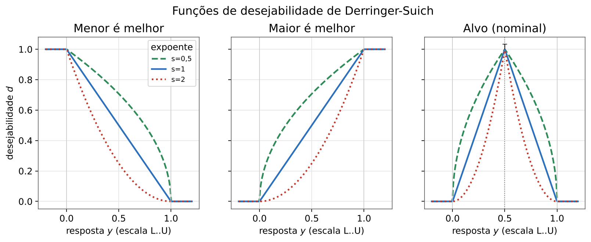
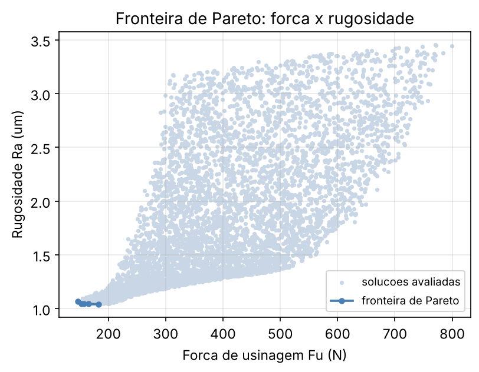

# Otimização multiresposta {#sec-cap6}

*Conciliando respostas conflitantes: desejabilidade, algoritmos genéticos e NSGA-II*

> Este capítulo enfrenta o problema central da usinagem real: otimizar várias respostas conflitantes ao mesmo tempo — minimizar força e rugosidade enquanto se maximiza a produtividade. Apresenta três abordagens complementares. A função desejabilidade de Derringer-Suich, que combina múltiplas respostas num único índice escalar. Os algoritmos genéticos (AG), que buscam o ótimo global por evolução de populações — o método usado no estudo de caso deste livro. E o NSGA-II, algoritmo multiobjetivo que entrega a fronteira de Pareto inteira, expondo os *trade-offs* em vez de escondê-los. Exemplos em Python (pymoo) e R (desirability) percorrem os métodos, com os modelos de segunda ordem do capítulo anterior como funções objetivo. Fecha com exercícios resolvidos passo a passo e uma lista de exercícios propostos.

## Introdução {#sec-cap6-intro}

O Capítulo @sec-cap5 mostrou como localizar o ótimo de **uma** resposta — a velocidade e o avanço que minimizam a força, por exemplo. Mas a usinagem real nunca tem uma resposta só. O engenheiro quer, simultaneamente, **força baixa** (menos potência, menos desgaste), **rugosidade baixa** (bom acabamento) e **produtividade alta** (mais remoção por minuto). E aqui está o problema: essas respostas **conflitam**.

Aumentar o avanço eleva a produtividade — mas piora a rugosidade e aumenta a força. Reduzir a velocidade pode diminuir a temperatura — mas reduz a taxa de remoção. Cada resposta puxa os fatores para um lado diferente. O ótimo da força não é o ótimo da rugosidade, que não é o ótimo da produtividade. Otimizar uma sozinha ignora as outras; e não existe um único ponto que seja o melhor para todas ao mesmo tempo.

Esse é o problema da **otimização multiresposta**, e resolvê-lo é o clímax metodológico deste livro. Este capítulo apresenta três abordagens, em ordem crescente de sofisticação:

1. A **função desejabilidade** de Derringer-Suich — combina as respostas num único índice, transformando o problema multiobjetivo em monobjetivo;
2. Os **algoritmos genéticos** (AG) — buscam o ótimo global por evolução de uma população de soluções, método aplicado no estudo de caso deste livro [@cus2006intellig; @baskar2006selectio];
3. O **NSGA-II** — algoritmo evolutivo multiobjetivo que, em vez de um único ótimo, entrega toda a **fronteira de Pareto**, expondo os *trade-offs* para a decisão do engenheiro.

::: {.callout-note}
## O que você vai conseguir fazer ao fim deste capítulo
Formular um problema de otimização multiresposta; construir e agregar funções desejabilidade; entender como um algoritmo genético evolui soluções; distinguir a abordagem escalar (desejabilidade, AG mono-objetivo) da abordagem de Pareto (NSGA-II); e implementar ambas em Python (pymoo) e R (desirability), usando os modelos de segunda ordem do capítulo anterior como funções objetivo.
:::

## O problema multiresposta {#sec-cap6-problema}

### Respostas em conflito

Formalmente, a otimização multiresposta busca os valores dos fatores $(x_1, \dots, x_k)$ que otimizam simultaneamente $m$ respostas $y_1, \dots, y_m$ — algumas a minimizar (força, rugosidade), outras a maximizar (produtividade, vida da ferramenta). Cada resposta é descrita por um modelo, tipicamente o de segunda ordem do Capítulo @sec-cap5:

$$\hat{y}_r = \beta_{0r} + \sum_i \beta_{ir} x_i + \sum_{i<j} \beta_{ijr} x_i x_j + \sum_i \beta_{iir} x_i^2$$

O conflito surge porque os coeficientes diferem entre respostas: o que minimiza $\hat{y}_1$ não minimiza $\hat{y}_2$. Não há "solução perfeita" — há **soluções de compromisso**.

### Duas filosofias de solução

Existem duas grandes filosofias para lidar com o conflito:

- **Escalarização** — combinar as $m$ respostas num único número (um escalar) e otimizá-lo. A função desejabilidade e o AG mono-objetivo seguem essa via. Vantagem: entrega uma resposta única, direta. Desvantagem: a combinação embute pesos e escolhas que escondem os *trade-offs*;
- **Abordagem de Pareto** — não combinar; buscar o conjunto de soluções em que não se pode melhorar uma resposta sem piorar outra (as soluções "não-dominadas"). O NSGA-II segue essa via. Vantagem: expõe todos os *trade-offs*, deixando a decisão final para o engenheiro. Desvantagem: entrega muitas soluções, não uma.

Este capítulo cobre as duas, porque ambas têm lugar: a escalarização quando se sabe o peso relativo das respostas; a de Pareto quando se quer ver o mapa completo de compromissos antes de decidir.

## A função desejabilidade de Derringer-Suich {#sec-cap6-desejabilidade}

O método clássico de escalarização em DOE é a **função desejabilidade**, proposta por Derringer e Suich. Sua ideia é elegante: traduzir cada resposta, em suas unidades próprias, para uma escala comum e adimensional de "desejabilidade" entre 0 e 1 — onde 0 é inaceitável e 1 é o ideal.

### Desejabilidades individuais

Para cada resposta $y_r$, define-se uma desejabilidade individual $d_r$ conforme o objetivo:

**Minimizar** (força, rugosidade) — quanto menor $y_r$, maior $d_r$:

$$d_r = \begin{cases} 1 & y_r \le L \\ \left(\dfrac{U - y_r}{U - L}\right)^s & L < y_r < U \\ 0 & y_r \ge U \end{cases}$$

**Maximizar** (produtividade) — quanto maior $y_r$, maior $d_r$:

$$d_r = \begin{cases} 0 & y_r \le L \\ \left(\dfrac{y_r - L}{U - L}\right)^s & L < y_r < U \\ 1 & y_r \ge U \end{cases}$$

Aqui $L$ e $U$ são os limites inferior e superior aceitáveis, e o expoente $s$ (o "peso") controla o rigor: $s > 1$ exige aproximar-se muito do ideal para pontuar bem; $s < 1$ é mais tolerante. Há também a forma "alvo" (target), para respostas que devem atingir um valor específico, nem maior nem menor.

{#fig-desejabilidade width=100%}

### A desejabilidade global

O passo genial é a agregação. As $m$ desejabilidades individuais combinam-se numa **desejabilidade global** $D$, pela média geométrica:

$$D = \left( d_1 \cdot d_2 \cdots d_m \right)^{1/m} = \left( \prod_{r=1}^{m} d_r \right)^{1/m}$$

A média **geométrica** (não a aritmética) é a escolha certa por uma razão poderosa: se **qualquer** resposta for inaceitável ($d_r = 0$), a desejabilidade global zera — $D = 0$. Isso reflete a realidade: uma solução com força ótima mas rugosidade inaceitável não serve. A média geométrica pune o pior componente, forçando um compromisso equilibrado entre todas as respostas.

Maximizar $D$ — agora um único escalar entre 0 e 1 — resolve o problema multiresposta. O ponto que dá o maior $D$ é a melhor solução de compromisso segundo os pesos escolhidos.

::: {.callout-note}
## Fundamentação matemática: a desejabilidade geral e os pesos
As formas acima são casos de uma definição mais geral. A desejabilidade global com **pesos** $w_r$ (a importância relativa de cada resposta) é a média geométrica ponderada
$$
D = \left( \prod_{r=1}^{m} d_r^{\,w_r} \right)^{1/\sum_r w_r},
$$
que recai na média geométrica simples quando todos os $w_r = 1$. Para uma resposta do tipo **alvo** $T$ (nem maior, nem menor), a desejabilidade é bilateral, com dois expoentes controlando cada lado:
$$
d_r = \begin{cases} \left(\dfrac{y_r - L}{T - L}\right)^{s} & L \le y_r \le T \\ \left(\dfrac{U - y_r}{U - T}\right)^{t} & T < y_r \le U \\ 0 & y_r \notin [L,U] \end{cases}
$$
A otimização maximiza $D(\mathbf{x})$ sobre a região experimental. Como $D$ não é suave — tem "quinas" onde algum $d_r$ atinge 0 ou 1 —, sua maximização pede busca com múltiplas partidas ou algoritmos globais, o que motiva os algoritmos genéticos da próxima seção.
:::

::: {.callout-tip}
## Na prática
Os limites $L$, $U$ e o alvo não são estatística — são **engenharia**. Você os define a partir de requisitos reais: a rugosidade máxima que o cliente aceita, a força que a máquina suporta, a produtividade mínima que o custo exige. A desejabilidade é o método; os limites são o seu conhecimento do processo entrando na otimização. Escolha-os com cuidado — eles determinam o resultado tanto quanto os dados.
:::

## Algoritmos genéticos {#sec-cap6-ag}

A função desejabilidade transforma o problema em "maximizar $D$" — mas *como* encontrar o máximo de $D$, que é uma função complexa, cheia de ótimos locais? Métodos determinísticos de subida de encosta (hill-climbing) ficam presos no primeiro pico que encontram. Os **algoritmos genéticos** resolvem isso — e foram a ferramenta de otimização do estudo de caso deste livro.

### Por que evolução

O algoritmo genético (AG) imita a evolução natural. Em vez de seguir uma única trajetória de subida (que trava num ótimo local), ele mantém uma **população** de soluções e a faz evoluir. Como busca em muitos pontos simultaneamente e usa regras probabilísticas, o AG é muito mais provável de **convergir para o ótimo global** do que os métodos determinísticos, que por definição encontram apenas ótimos locais [@abdelmagif1997optimal; @huntley1996parallel].

Essa é a razão de sua popularidade em usinagem: os problemas de otimização de condições de corte têm superfícies acidentadas, com múltiplos ótimos locais, onde o AG brilha [@cus2006intellig; @baskar2006selectio].

### As três regras

O AG evolui a população por gerações sucessivas, aplicando três operadores [@abdelmagif1997optimal]:

1. **Seleção (reprodução)** — os melhores indivíduos (maior valor da função objetivo) são escolhidos como "pais";
2. **Cruzamento (*crossover*)** — pares de pais combinam-se, gerando "filhos" que herdam características de ambos;
3. **Mutação** — mudanças aleatórias em alguns indivíduos, que introduzem diversidade e evitam a convergência prematura.

A cada geração, a população melhora — os bons se reproduzem, os ruins desaparecem. Após muitas gerações, ela converge para um conjunto de soluções ótimas [@abdelmagif1996tuning; @baskar2006selectio].

### A terminologia do AG

Vale fixar o vocabulário, que reaparece no código:

- **Função objetivo (*fitness function*)** — o que se quer otimizar (por exemplo, a desejabilidade global $D$, ou uma resposta direta);
- **Indivíduo (genoma)** — um ponto candidato, um conjunto de valores dos fatores $(x_1, \dots, x_k)$;
- **População** — a matriz de indivíduos da geração atual;
- **Geração** — cada nova população produzida por uma iteração;
- **Diversidade** — a distância média entre indivíduos; alta diversidade permite explorar mais do espaço de busca;
- **Valor ajustado (*fitness value*)** — o valor da função objetivo para um indivíduo;
- **Pais e filhos** — os selecionados e os gerados por cruzamento.

Guardar esse vocabulário é ler o código de otimização com fluência — os pacotes usam exatamente esses termos.

## Comparação: desejabilidade × AG × NSGA-II {#sec-cap6-comparacao}

As três abordagens não competem — complementam-se. O Quadro @tbl-comparacao situa cada uma.

| Aspecto | Desejabilidade | Algoritmo genético (mono) | NSGA-II (multi) |
|:--------|:--------------:|:-------------------------:|:---------------:|
| Filosofia | Escalarização | Escalarização | Pareto |
| Saída | Um ponto ótimo | Um ponto ótimo (global) | Fronteira de Pareto |
| Trade-offs | Escondidos nos pesos | Escondidos na função | Explícitos |
| Ótimo local? | Pode travar | Evita (busca global) | Evita (busca global) |
| Melhor quando... | Pesos conhecidos | Superfície acidentada | Trade-offs a explorar |

: Comparação das três abordagens de otimização multiresposta. {#tbl-comparacao}

### De um ótimo à fronteira de Pareto

A desejabilidade e o AG mono-objetivo entregam **um** ponto — a melhor solução dados os pesos. Mas e se você não souber os pesos de antemão? E se quiser *ver* o que custa ganhar 10% de produtividade em termos de rugosidade?

O **NSGA-II** (Non-dominated Sorting Genetic Algorithm II) responde. É um AG multiobjetivo que não escalariza: ele busca o conjunto de soluções **não-dominadas** — aquelas em que não se pode melhorar uma resposta sem piorar outra. Esse conjunto forma a **fronteira de Pareto**: o mapa completo dos compromissos possíveis.

::: {.callout-note}
## Fundamentação matemática: dominância de Pareto e o NSGA-II
Com múltiplos objetivos, "melhor" deixa de ser uma ordem total. Uma solução $\mathbf{a}$ **domina** $\mathbf{b}$ quando é pelo menos tão boa em todos os objetivos e estritamente melhor em ao menos um:
$$
\mathbf{a} \prec \mathbf{b} \iff f_i(\mathbf{a}) \le f_i(\mathbf{b})\ \ \forall i \ \ \text{e} \ \ \exists\, j: f_j(\mathbf{a}) < f_j(\mathbf{b}).
$$
As soluções não dominadas por nenhuma outra formam a **fronteira de Pareto**. O **NSGA-II** evolui a população rumo a ela com dois mecanismos. Primeiro, a **ordenação por não dominância**: a população é estratificada em frentes $F_1, F_2, \ldots$, onde $F_1$ são as não dominadas, $F_2$ as dominadas apenas por $F_1$, e assim por diante. Segundo, a **distância de aglomeração** (*crowding distance*): dentro de uma frente, prefere-se as soluções mais isoladas — a distância é a soma, por objetivo, do intervalo entre os dois vizinhos imediatos —, o que espalha a população e impede que ela se amontoe num só trecho da fronteira. A seleção favorece primeiro a frente mais baixa e, dentro dela, a maior distância de aglomeração: o algoritmo **converge** para a fronteira e ao mesmo tempo **cobre** toda a sua extensão.
:::

Em vez de dizer "a solução ótima é esta", o NSGA-II diz "estas são todas as soluções eficientes; escolha o compromisso que preferir". Numa fronteira força × rugosidade, cada ponto é uma condição de corte não-dominada; caminhar pela fronteira mostra exatamente quanto de rugosidade se sacrifica por cada newton de força economizado. A decisão final — o peso relativo — fica com o engenheiro, informada pelo mapa completo.

::: {.callout-important}
## Decisão de projeto
Escalarizar (desejabilidade, AG mono) ou mapear Pareto (NSGA-II)? A regra: se você **já sabe** a importância relativa das respostas (o cliente exige rugosidade abaixo de X, custe o que custar), escalarize — é direto e dá a resposta. Se você **quer descobrir** o *trade-off* antes de decidir, use NSGA-II e leia a fronteira. Em projetos reais, é comum fazer os dois: NSGA-II para entender o espaço, depois desejabilidade para cravar a condição de operação escolhida.
:::

## Exemplo em R: função desejabilidade {#sec-cap6-exemplo-r}

O pacote **desirability** do R implementa Derringer-Suich diretamente sobre os modelos de segunda ordem do capítulo anterior.

> **Código demonstrativo.** A versão completa e executável, com os dados reais, está no @sec-apendice-b e no repositório de códigos.

```r

# install.packages("desirability")
library(desirability)

# Suponha modelos de 2a ordem ajustados no Cap 5 (pacote rsm):
#   modelo_Fu  -> forca de usinagem (minimizar)
#   modelo_Ra  -> rugosidade (minimizar)
#   modelo_MRR -> taxa de remocao (maximizar)

# Desejabilidades individuais (limites vindos da ENGENHARIA)
d_Fu  <- dMin(low = 200, high = 600)   # forca: ideal <=200 N, inaceit. >=600
d_Ra  <- dMin(low = 0.4, high = 3.2)   # rugosidade: ideal <=0.4 um
d_MRR <- dMax(low = 10,  high = 80)    # remocao: ideal >=80 cm3/min

# Desejabilidade global (media geometrica) via dOverall
D <- dOverall(d_Fu, d_Ra, d_MRR)

# Funcao objetivo: predizer as 3 respostas num ponto e agregar
objetivo <- function(x) {
  fu  <- predict(modelo_Fu,  newdata = data.frame(x1=x[1], x2=x[2], x3=x[3]))
  ra  <- predict(modelo_Ra,  newdata = data.frame(x1=x[1], x2=x[2], x3=x[3]))
  mrr <- predict(modelo_MRR, newdata = data.frame(x1=x[1], x2=x[2], x3=x[3]))
  predict(D, data.frame(D1=fu, D2=ra, D3=mrr))   # D global
}

# Maximizar D com otimizacao (busca a melhor condicao de corte)
otimo <- optim(par = c(0,0,0), fn = function(x) -objetivo(x),
               method = "L-BFGS-B", lower = -1.5, upper = 1.5)
cat("Condicao otima (codificada):", otimo$par, "\n")
cat("Desejabilidade global D =", -otimo$value, "\n")
```

O `dMin`/`dMax` criam as desejabilidades individuais; `dOverall` faz a média geométrica; e `optim` busca o ponto de máxima desejabilidade global. O resultado é a condição de corte de melhor compromisso.

## Exemplo em Python: NSGA-II com pymoo {#sec-cap6-exemplo-py}

Para a fronteira de Pareto, o Python oferece o **pymoo**, biblioteca de referência em otimização multiobjetivo. O exemplo abaixo aplica o NSGA-II aos modelos de segunda ordem, buscando minimizar força e rugosidade simultaneamente.

```python

import numpy as np
from pymoo.core.problem import Problem
from pymoo.algorithms.moo.nsga2 import NSGA2
from pymoo.optimize import minimize

# Modelos de 2a ordem (coeficientes vindos da regressao do Cap 5).
# Aqui, funcoes que preveem Fu e Ra a partir dos fatores codificados.
def modelo_Fu(x1, x2, x3):
    return 380 + 120*x1 + 15*x2 + 90*x3 + 25*x1*x3 + 18*x1**2

def modelo_Ra(x1, x2, x3):
    return 1.6 + 0.1*x1 + 0.7*x3 + 0.3*x3**2

# Problema multiobjetivo: 3 variaveis, 2 objetivos (ambos minimizar)
class UsinagemMulti(Problem):
    def __init__(self):
        super().__init__(n_var=3, n_obj=2,
                         xl=np.array([-1.5,-1.5,-1.5]),
                         xu=np.array([ 1.5, 1.5, 1.5]))
    def _evaluate(self, X, out, *args, **kwargs):
        x1, x2, x3 = X[:,0], X[:,1], X[:,2]
        f1 = modelo_Fu(x1, x2, x3)   # minimizar forca
        f2 = modelo_Ra(x1, x2, x3)   # minimizar rugosidade
        out["F"] = np.column_stack([f1, f2])

# Roda o NSGA-II
resultado = minimize(UsinagemMulti(), NSGA2(pop_size=100),
                     ("n_gen", 200), seed=1, verbose=False)

# resultado.F contem a fronteira de Pareto (forca vs rugosidade)
print("Solucoes na fronteira de Pareto:", len(resultado.F))
print(resultado.F[:5])   # primeiras 5 solucoes nao-dominadas
```

O `Problem` define os objetivos (aqui, força e rugosidade, ambos a minimizar); `NSGA2` é o algoritmo; e `resultado.F` traz a fronteira de Pareto — o conjunto de condições de corte não-dominadas. Cada linha é um compromisso força × rugosidade que o engenheiro pode escolher.

### Visualizando a fronteira

```python

import matplotlib.pyplot as plt

F = resultado.F
plt.scatter(F[:,0], F[:,1], c="steelblue", s=20)
plt.xlabel("Forca de usinagem Fu (N)")
plt.ylabel("Rugosidade Ra (um)")
plt.title("Fronteira de Pareto: forca vs rugosidade")
plt.grid(True, alpha=0.3)
plt.show()
```

O gráfico da fronteira é a entrega final: cada ponto é uma condição de corte eficiente. O joelho da curva — onde ela "dobra" — costuma ser o melhor compromisso prático, o ponto em que pequenos ganhos numa resposta passam a custar muito na outra.

{#fig-fronteira width=80%}

::: {.callout-warning}
## Erro comum
Confundir "muitas soluções de Pareto" com "o algoritmo não decidiu". A fronteira de Pareto **não é indecisão** — é informação. Ela mostra que não existe uma única resposta certa, porque o problema é genuinamente de compromisso. Reduzir a fronteira a um ponto exige um julgamento de valor (os pesos), e esse julgamento é do engenheiro, não do algoritmo. O NSGA-II faz sua parte: entrega o mapa. Escolher o destino é com você.
:::

## Síntese do capítulo {#sec-cap6-sintese}

O Quadro @tbl-sintese6 fecha a Parte II resumindo o arsenal de otimização.

| Método | Tipo | Entrega | Ferramenta |
|:-------|:-----|:--------|:-----------|
| Desejabilidade | Escalar | Um ótimo (pesos dados) | R: desirability |
| Algoritmo genético | Escalar, global | Um ótimo global | R: GA / Python: DEAP |
| NSGA-II | Pareto, global | Fronteira completa | Python: pymoo |

: Síntese das abordagens de otimização multiresposta. {#tbl-sintese6}

Três ideias devem permanecer:

1. **Respostas conflitam; não há ótimo único.** Otimização multiresposta é a arte do compromisso — minimizar força e rugosidade *e* maximizar produtividade nunca coincidem num só ponto.
2. **Escalarizar dá uma resposta; Pareto dá o mapa.** A desejabilidade e o AG entregam um ótimo (embutindo pesos); o NSGA-II entrega a fronteira, expondo os *trade-offs*.
3. **A decisão final é de engenharia.** Os métodos otimizam; os limites, os pesos e a escolha na fronteira vêm do conhecimento do processo — a estatística informa, o engenheiro decide.

Com este capítulo, a Parte II está completa: o leitor domina o fatorial (triagem), o PCC/RSM (modelagem) e a otimização multiresposta (decisão). A Parte III aplica todo esse arsenal ao estudo de caso real — o torneamento das seis ligas de alumínio — transformando a metodologia em resultados.

## Para saber mais {#sec-cap6-saibamais}

::: {.callout-tip}
## Aprofundamento
A função desejabilidade tem sua origem no trabalho clássico de Derringer e Suich; Montgomery [@montgomery2005design] a apresenta no contexto de RSM. Sobre algoritmos genéticos em usinagem, @cus2006intellig e @baskar2006selectio trazem aplicações a condições de corte, e @abdelmagif1997optimal discute a convergência ao ótimo global. Para otimização multiobjetivo e NSGA-II, a documentação do pymoo (pymoo.org) é excelente e prática. O pacote desirability do R, de Max Kuhn, tem vinheta detalhada sobre Derringer-Suich.
:::

## Exercícios resolvidos {#sec-cap6-resolvidos .unnumbered}

Os três exercícios a seguir resolvem, passo a passo, o núcleo do capítulo — desejabilidade individual, desejabilidade global e dominância de Pareto —, usando os mesmos limites de engenharia do exemplo em R (Seção @sec-cap6-exemplo-r), com expoente $s = 1$ (linear):

| Resposta | Objetivo | $L$ | $U$ |
|:---------|:--------:|:---:|:---:|
| Força $F_u$ (N) | minimizar | 200 | 600 |
| Rugosidade $R_a$ (µm) | minimizar | 0,4 | 3,2 |
| Remoção $MRR$ (cm³/min) | maximizar | 10 | 80 |

: Limites de desejabilidade usados nos exercícios. {#tbl-limites-desej}

### Resolvido 1 — Desejabilidades individuais {.unnumbered}

**Enunciado.** Uma condição de corte produz força $F_u = 360$ N, rugosidade $R_a = 1{,}6$ µm e taxa de remoção $MRR = 50$ cm³/min. Calcule a desejabilidade individual de cada resposta.

**Solução.** Força e rugosidade são "menor-melhor" (fórmula de minimizar); a remoção é "maior-melhor" (fórmula de maximizar), todas com $s = 1$:

$$
d_{F_u} = \frac{U - y}{U - L} = \frac{600 - 360}{600 - 200} = \frac{240}{400} = 0{,}600 ,
$$
$$
d_{R_a} = \frac{3{,}2 - 1{,}6}{3{,}2 - 0{,}4} = \frac{1{,}6}{2{,}8} = 0{,}571 ,
\qquad
d_{MRR} = \frac{y - L}{U - L} = \frac{50 - 10}{80 - 10} = \frac{40}{70} = 0{,}571 .
$$

**Interpretação.** Cada resposta, em sua unidade própria (N, µm, cm³/min), virou um número adimensional entre 0 e 1. A força está um pouco melhor (0,60) que as outras duas (0,57); nenhuma é excelente (perto de 1) nem inaceitável (0). É um ponto de compromisso mediano — o que a desejabilidade global vai resumir num só número.

### Resolvido 2 — Desejabilidade global e o poder da média geométrica {.unnumbered}

**Enunciado.** (a) Agregue as três desejabilidades do Resolvido 1 na desejabilidade global $D$. (b) Em outra condição, a força sobe para $F_u = 620$ N (as demais permanecem boas). Recalcule $D$ e explique o que a média geométrica faz.

**Solução.** (a) A desejabilidade global é a média geométrica das $m = 3$ individuais:

$$
D = \left( d_{F_u} \cdot d_{R_a} \cdot d_{MRR} \right)^{1/3} = \left( 0{,}600 \times 0{,}571 \times 0{,}571 \right)^{1/3} = (0{,}1959)^{1/3} = 0{,}581 .
$$

(b) Com $F_u = 620$ N $\ge U = 600$, a força cai para a faixa **inaceitável**: $d_{F_u} = 0$. Logo

$$
D = \left( 0 \times d_{R_a} \times d_{MRR} \right)^{1/3} = 0 .
$$

**Interpretação.** Um único componente inaceitável **zera** a desejabilidade global — exatamente o que se quer: de nada adianta rugosidade e remoção ótimas se a força estoura o limite da máquina. A média **aritmética** daria $(0 + 0{,}571 + 0{,}571)/3 = 0{,}38$, sugerindo falsamente uma solução "razoável". A média geométrica pune o pior componente e força o compromisso — é por isso que Derringer-Suich a adota. (Note que, no caso equilibrado do item (a), as duas médias quase coincidem; a diferença só aparece — e decide — quando um componente vai mal.)

### Resolvido 3 — Dominância e fronteira de Pareto {.unnumbered}

**Enunciado.** Quatro condições de corte dão os pares (força, rugosidade), ambas a minimizar: S1 (300; 2,0), S2 (350; 1,5), S3 (400; 1,4) e S4 (380; 1,8). Quais estão na fronteira de Pareto e qual é descartada?

**Solução.** Uma solução **domina** outra se é igual ou melhor em **todas** as respostas e estritamente melhor em pelo menos uma. Comparando S4 com S2:

$$
\text{S2}(350;\,1{,}5) \ \text{vs}\ \text{S4}(380;\,1{,}8): \quad 350 < 380 \ \text{e}\ 1{,}5 < 1{,}8 .
$$

S2 é melhor em **força e** rugosidade — logo **S2 domina S4**, e S4 sai. Entre S1, S2 e S3, nenhuma domina outra: S1 tem a menor força mas a maior rugosidade; S3, a menor rugosidade mas a maior força; S2 fica no meio. São **não-dominadas**.

$$
\text{Fronteira de Pareto} = \{\,\text{S1},\ \text{S2},\ \text{S3}\,\}, \qquad \text{S4 dominada (descartada)} .
$$

**Interpretação.** É isto que o NSGA-II entrega: o conjunto {S1, S2, S3}, cada ponto um compromisso válido — descer a rugosidade custa subir a força e vice-versa. A desejabilidade e o AG mono-objetivo, ao contrário, escolheriam **um** desses três conforme os pesos (os limites $L$, $U$ e o expoente $s$). Escalarizar dá a resposta; Pareto dá o mapa — a comparação da Seção @sec-cap6-comparacao em números.

::: {.callout-tip}
## O fio dos três exercícios
A desejabilidade individual (1) traduz cada resposta para [0, 1]; a global (2) agrega com uma média que pune o pior componente; e a dominância (3) mostra a alternativa — não agregar, e expor todos os compromissos na fronteira de Pareto. São as duas filosofias do capítulo — escalarização e Pareto — reduzidas às suas contas essenciais.
:::

## Exercícios propostos {.unnumbered}

1. **Conflito.** Dê um exemplo concreto, da usinagem, de duas respostas que conflitam — em que otimizar uma piora a outra. Explique fisicamente (use a mecânica do Capítulo @sec-cap3).

2. **Desejabilidade individual.** Uma rugosidade deve ser minimizada, com $L = 0{,}5$ µm (ideal) e $U = 3{,}0$ µm (inaceitável), expoente $s = 1$. Calcule $d$ para $Ra = 1{,}5$ µm. E para $Ra = 3{,}5$ µm?

3. **Média geométrica.** Três desejabilidades individuais valem $d_1 = 0{,}9$, $d_2 = 0{,}8$, $d_3 = 0$. Calcule a desejabilidade global $D$. Por que a média geométrica é preferível à aritmética aqui?

4. **Algoritmo genético.** Descreva as três regras do AG (seleção, cruzamento, mutação) e explique o papel de cada uma. Por que a mutação é necessária, se a seleção já escolhe os melhores?

5. **Global vs local.** Explique por que um algoritmo genético tem mais chance de encontrar o ótimo global do que um método de subida de encosta (hill-climbing). Relacione com o conceito de população e diversidade.

6. **Pareto (integrador).** Explique o que significa uma solução ser "não-dominada". Numa fronteira de Pareto força × rugosidade, o que representa o "joelho" da curva, e por que ele costuma ser um bom compromisso prático? Como você usaria o NSGA-II (pymoo) e depois a desejabilidade (R) de forma combinada num projeto real?

## Gabarito dos exercícios propostos {#sec-cap6-gabarito .unnumbered}

1. **Conflito.** Aumentar o **avanço** eleva a taxa de remoção (produtividade), mas piora a **rugosidade** (sulcos de avanço maiores) e tende a elevar a **força**. Otimizar a produtividade degrada o acabamento — conflito direto, pela geometria do cavaco (Capítulo @sec-cap3).

2. **Desejabilidade individual.** Minimizar, $L=0{,}5$, $U=3{,}0$, $s=1$. Para $R_a=1{,}5$: $d=\dfrac{3{,}0-1{,}5}{3{,}0-0{,}5}=\dfrac{1{,}5}{2{,}5}=0{,}60$. Para $R_a=3{,}5\ge U$: $d=0$ (inaceitável).

3. **Média geométrica.** $D=(0{,}9\cdot0{,}8\cdot0)^{1/3}=0$. A média geométrica **zera** quando qualquer $d_r=0$ — uma resposta inaceitável invalida a solução inteira. A aritmética daria $(0{,}9+0{,}8+0)/3=0{,}567$, mascarando o componente inaceitável.

4. **Algoritmo genético.** *Seleção*: escolhe os melhores indivíduos como pais (pressão de melhoria). *Cruzamento*: combina pares de pais, explorando novas combinações de boas características. *Mutação*: altera aleatoriamente alguns genes, mantendo **diversidade** e evitando convergência prematura — sem ela, a seleção empobreceria a população e ela ficaria presa num ótimo local.

5. **Global vs. local.** O AG mantém uma **população** espalhada pelo espaço de busca, explorando vários "vales" ao mesmo tempo; o hill-climbing segue um único caminho de subida e para no primeiro pico. A diversidade (população + mutação) dá ao AG chance de **escapar de ótimos locais** e encontrar o global.

6. **Pareto (integrador).** Uma solução é **não-dominada** quando nenhuma outra é melhor em **todas** as respostas simultaneamente. O **"joelho"** da fronteira é o ponto de maior curvatura — onde continuar melhorando uma resposta passa a custar muito na outra; costuma ser o melhor compromisso prático. Uso combinado: **NSGA-II (pymoo)** para mapear a fronteira e enxergar os trade-offs; depois **desejabilidade (R)** para cravar um ponto, dados os limites e pesos do projeto.
