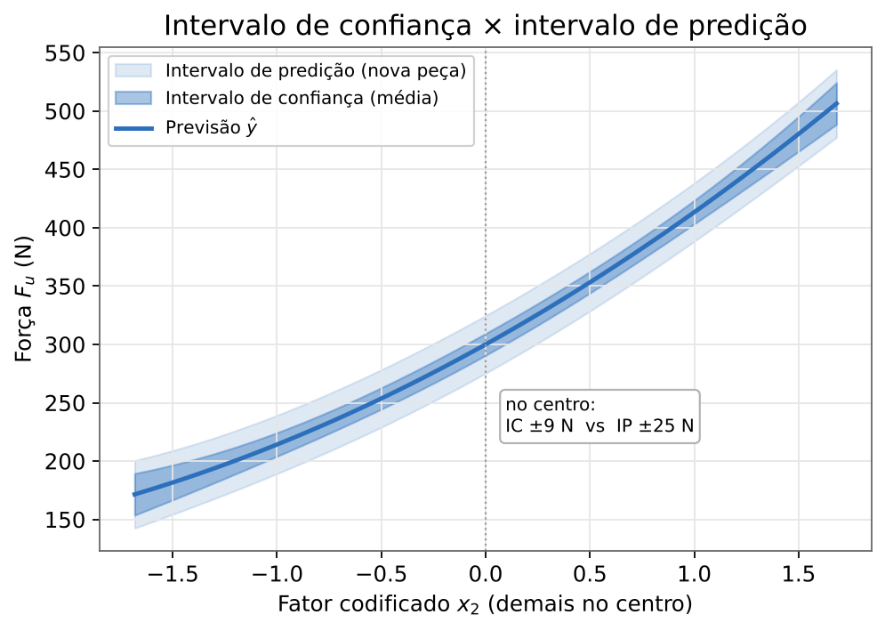

# Incerteza de medição e reprodutibilidade {#sec-cap-incerteza}

*Quanto confiar nos números que o experimento produz*

> Todo resultado experimental traz uma incerteza — e ignorá-la é a forma mais sutil de errar. Este capítulo curto fecha a metodologia com o rigor que falta: a incerteza de medição e a reprodutibilidade das conclusões do DOE. Apresenta a estrutura do GUM para quantificar e propagar incerteza, distingue o intervalo de confiança do intervalo de predição — uma confusão frequente e cara —, mostra como a validação cruzada e o bootstrap estimam a incerteza sem fórmulas fechadas, e discute como a incerteza de medição afeta quais efeitos podemos declarar reais. Fecha propagando a incerteza até o ponto ótimo do estudo de caso, para que a recomendação final venha com sua margem de confiança explícita.

## Introdução {#sec-cap-incerteza-intro}

Os capítulos anteriores estimaram efeitos, ajustaram modelos e localizaram ótimos. Todos esses números são **estimativas** — vêm de medições com erro e de amostras finitas. A pergunta que fecha a metodologia é: **quanto confiar neles?** Um efeito de 100 N estimado com incerteza de 3 N é um fato sólido; o mesmo 100 N com incerteza de 60 N é quase ruído. Sem a incerteza, o número sozinho mente por omissão.

Este capítulo traz o rigor da metrologia para o DOE. Não introduz novos planejamentos; qualifica os resultados dos que já vimos. Três ferramentas organizam o capítulo: a **propagação de incerteza** (como a incerteza das medições chega às conclusões), os **intervalos** (de confiança e de predição, que não são a mesma coisa) e os **métodos de reamostragem** (validação cruzada e bootstrap, que estimam incerteza quando a fórmula fechada falta).

::: {.callout-note}
## Onde este capítulo se conecta
Os efeitos do fatorial (Capítulo @sec-cap4) e os modelos de superfície de resposta (Capítulo @sec-cap5) produzem estimativas; aqui as qualificamos com sua incerteza. O exemplo final propaga a incerteza até a condição ótima do estudo de caso (Capítulo @sec-cap10), para que a recomendação saia com sua margem — não como um número seco.
:::

## A incerteza de medição e o GUM {#sec-cap-incerteza-gum}

A referência internacional para tratar incerteza é o **GUM** (*Guide to the Expression of Uncertainty in Measurement*). Ele organiza a incerteza em duas categorias, pela forma de avaliá-la:

- **Tipo A** — avaliada por métodos estatísticos a partir de medições repetidas (o desvio-padrão da média de réplicas);
- **Tipo B** — avaliada por outros meios: especificação do fabricante do instrumento, certificado de calibração, resolução do display, julgamento técnico.

Cada fonte contribui uma **incerteza padrão** $u(x_i)$ (um desvio-padrão). Quando a grandeza de interesse $y$ é função de várias entradas, $y = f(x_1, \ldots, x_m)$, a **incerteza padrão combinada** segue a **lei de propagação de incerteza** (para entradas independentes):

$$
u_c^2(y) = \sum_{i=1}^{m} \left( \frac{\partial f}{\partial x_i} \right)^2 u^2(x_i).
$$ {#eq-gum}

Cada derivada parcial é um **coeficiente de sensibilidade**: quanto $y$ muda por unidade de $x_i$. Fontes às quais $y$ é mais sensível pesam mais. Por fim, a **incerteza expandida** fornece um intervalo de confiança aproximado:

$$
U = k \, u_c(y),
$$

com **fator de abrangência** $k \approx 2$ para cerca de 95% de confiança. O resultado se reporta como $y \pm U$.

::: {.callout-tip}
## A ligação com o DOE
A @eq-gum é exatamente o que um modelo de regressão faz: o modelo $\hat{y} = f(\mathbf{x})$ é a função, e a incerteza dos coeficientes propaga-se para a predição. Por isso o intervalo de confiança da predição (a seguir) **é** uma propagação de incerteza — a do GUM, com a estrutura do mínimos quadrados.
:::

## Intervalo de confiança × intervalo de predição {#sec-cap-incerteza-intervalos}

Esta é a distinção que mais se confunde — e confundi-la custa decisões erradas. Após ajustar um modelo, há **duas** perguntas diferentes sobre um ponto $\mathbf{x}_0$:

- **Intervalo de confiança (IC)** — onde está a **média verdadeira** da resposta em $\mathbf{x}_0$? Mede a incerteza do **modelo** (dos coeficientes estimados). Encolhe à medida que se acumulam dados;
- **Intervalo de predição (IP)** — onde cairá **uma próxima peça** usinada em $\mathbf{x}_0$? Soma à incerteza do modelo a **variabilidade natural** entre peças. É sempre **mais largo** que o IC, e **não** encolhe a zero: mesmo com infinitos dados, uma peça individual ainda varia.

Formalmente, com $s$ o desvio-padrão residual e $h_0 = \mathbf{x}_0^{\!\top}(\mathbf{X}^{\!\top}\mathbf{X})^{-1}\mathbf{x}_0$ a alavancagem do ponto:

$$
\text{IC}: \ \hat{y}_0 \pm t\, s\sqrt{h_0},
\qquad
\text{IP}: \ \hat{y}_0 \pm t\, s\sqrt{1 + h_0}.
$$ {#eq-ic-ip}

O termo extra "$1 +$" no IP é a variância de uma observação nova. A regra prática: **use o IC para falar do processo** (a média), **o IP para falar de uma peça** (o individual). Prometer ao cliente que "cada peça terá rugosidade dentro do IC" é um erro — o que vale para peças individuais é o IP, mais largo.

## Validação cruzada e bootstrap {#sec-cap-incerteza-reamostragem}

Nem toda incerteza tem fórmula fechada. Quando o modelo é complexo (uma rede neural, Capítulo @sec-cap-ann) ou quando se quer a incerteza de uma quantidade derivada (um ótimo, uma razão de efeitos), a **reamostragem** estima a incerteza diretamente dos dados.

- **Validação cruzada** (vista no Capítulo @sec-cap-ann) estima o **erro de predição** em dados não vistos. O deixa-um-fora (LOO) é sua forma extrema para amostras pequenas, típica do DOE;
- **Bootstrap** estima a **distribuição de uma estimativa** reamostrando os dados com reposição, reajustando a cada reamostra e observando como a estimativa varia. O desvio-padrão dessas réplicas é o **erro padrão bootstrap**; os percentis 2,5% e 97,5% dão um IC de 95%.

::: {.callout-warning}
## Bootstrap em experimento planejado
Num DOE, a matriz de projeto é **fixa** — os pontos foram escolhidos pelo experimentador, não sorteados. Por isso o bootstrap correto reamostra os **resíduos** (mantendo o projeto intacto), não os casos. Reamostrar casos num planejamento pequeno pode remover os pontos axiais ou centrais e deixar o modelo indeterminado. É um erro silencioso que produz erros padrão absurdos.
:::

## Como a incerteza afeta as conclusões {#sec-cap-incerteza-conclusoes}

A incerteza de medição decide **quais efeitos podemos declarar reais**. Um efeito só é significativo se for grande em relação à sua incerteza — é o que a razão $t = \text{efeito}/\text{EP}$ formaliza (Capítulo @sec-cap4): $|t| > 2$ (aproximadamente) para declarar o efeito real a 95%.

Daí uma consequência prática incontornável: **medição ruim mascara efeitos reais e inventa efeitos falsos**. Se a incerteza de medição da força é de 30 N, um efeito verdadeiro de 20 N fica submerso no ruído e será declarado "não significativo"; e flutuações aleatórias podem, por acaso, parecer efeitos. Investir em metrologia — calibrar o dinamômetro, repetir medições, controlar a temperatura — não é zelo excessivo: é o que determina a **resolução** do experimento, o menor efeito que ele consegue enxergar. Um DOE impecável sobre medições ruins é um microscópio apontado para um vidro embaçado.

## Exemplo resolvido: incerteza até o ponto ótimo {#sec-cap-incerteza-exemplo}

Retomamos o conjunto didático do PCC usado no Capítulo @sec-cap-ann (mesma matriz, mesma semente), ajustando o modelo de segunda ordem da força. O ajuste tem desvio-padrão residual $s = 10{,}3$ N, $R^2 = 0{,}995$, com 10 parâmetros e 10 graus de liberdade ($t_{0{,}975;10} = 2{,}228$).

### Intervalo de confiança × predição {.unnumbered}

No ponto central $(0,0,0)$, o modelo prevê $\hat{y} = 300{,}0$ N. Aplicando @eq-ic-ip:

| Intervalo | Fórmula | Resultado (N) | Meia-largura |
|:---|:---|:---:|:---:|
| Confiança (média) | $\hat{y} \pm t\,s\sqrt{h_0}$ | [290,6, 309,3] | ±9,3 |
| Predição (nova peça) | $\hat{y} \pm t\,s\sqrt{1+h_0}$ | [275,2, 324,7] | ±24,7 |

: Intervalo de confiança e de predição no ponto central. {#tbl-ic-ip}

O **intervalo de predição é 2,7 vezes mais largo** que o de confiança: a média do processo é conhecida a ±9 N, mas uma peça individual pode cair em uma faixa de ±25 N. Nas **bordas** do domínio a diferença muda de caráter: num ponto axial ($a_p = +1{,}68$), a alavancagem $h_0$ cresce e o próprio IC alarga para ±17,8 N — longe do centro, o modelo é menos preciso, e extrapolar além dos pontos amostrados amplia ainda mais a incerteza.

{#fig-ic-ip width=85%}

### Bootstrap de um efeito {.unnumbered}

O coeficiente linear da profundidade $a_p$ — o fator dominante da força — vale $99{,}6$ N, com erro padrão analítico de $2{,}78$ N. Um **bootstrap de resíduos** com 5000 reamostras (o método correto para o projeto fixo) devolve erro padrão de $2{,}78$ N e intervalo de 95% de $[93{,}9;\ 104{,}9]$ N — idêntico ao analítico, confirmando a estimativa por via independente de qualquer suposição de normalidade. A razão $t = 99{,}6/2{,}78 = 35{,}8$ coloca o efeito muito acima do limiar de significância: é um fato sólido, não ruído.

O contraste ilumina a @sec-cap-incerteza-conclusoes: um efeito hipotético de apenas $5$ N, com o mesmo erro padrão de $2{,}78$ N, daria $t = 1{,}8 < 2{,}23$ — **indistinguível do ruído** com esses dados. O mesmo experimento declara real o efeito de $a_p$ e não consegue afirmar nada sobre um efeito de 5 N: sua resolução está entre esses dois valores, e melhorá-la exigiria mais réplicas ou medição mais precisa.

### Propagando até o ótimo {.unnumbered}

A condição ótima recomendada ao fim do estudo de caso (Capítulo @sec-cap10) é um ponto $\mathbf{x}^{*}$ no espaço dos fatores, e a resposta prevista ali, $\hat{y}(\mathbf{x}^{*})$, carrega a mesma estrutura: um **IC** (quão bem conhecemos a média no ótimo) e um **IP** (o que esperar de uma peça feita no ótimo). Reportar o ótimo como "$\hat{y}(\mathbf{x}^{*}) \pm U$", com $U = 2\,u_c$, transforma a recomendação de um número seco numa afirmação honesta: *esta é a melhor condição, e esta é a confiança que temos nela*. É assim que a otimização deixa de prometer precisão que não tem.

::: {.callout-important}
## Decisão de projeto
Toda recomendação final de um DOE deve vir com seu intervalo. Um ótimo sem incerteza convida a decisões frágeis — o leitor supõe precisão infinita onde há ±25 N por peça. Apresentar o IP ao lado do ótimo não enfraquece a recomendação: fortalece-a, porque mostra que a margem foi medida, não ignorada.
:::

## Código: intervalos e bootstrap {#sec-cap-incerteza-codigo}

```r
# R: IC e IP de um modelo de 2a ordem num ponto
mod <- lm(y ~ poly(vc, ap, f, degree = 2, raw = TRUE), data = dados)
x0  <- data.frame(vc = 0, ap = 0, f = 0)
predict(mod, x0, interval = "confidence")  # IC da media
predict(mod, x0, interval = "prediction")  # IP de nova observacao

# bootstrap de residuos de um efeito (projeto FIXO)
set.seed(42)
fit <- fitted(mod); r <- residuals(mod) - mean(residuals(mod))
rc  <- r * sqrt(length(r) / mod$df.residual)   # correcao de variancia
coef_ap <- replicate(5000, {
  ys <- fit + sample(rc, replace = TRUE)
  coef(lm(ys ~ poly(vc, ap, f, degree = 2, raw = TRUE), data = dados))["ap"]
})
sd(coef_ap); quantile(coef_ap, c(.025, .975))
```

```python
# Python: IC/IP manuais e bootstrap de residuos (numpy)
import numpy as np
from scipy import stats
# Z = matriz de projeto (intercepto + termos); y = resposta; beta = OLS
ZtZ_inv = np.linalg.inv(Z.T @ Z)
resid = y - Z @ beta
s2 = resid @ resid / (len(y) - Z.shape[1])
t = stats.t.ppf(0.975, len(y) - Z.shape[1])
z0 = ...                       # linha do ponto x0 na base do modelo
h0 = z0 @ ZtZ_inv @ z0
ic = t * np.sqrt(s2 * h0)      # meia-largura do IC (media)
ip = t * np.sqrt(s2 * (1 + h0))# meia-largura do IP (nova obs)
```

## Síntese do capítulo {#sec-cap-incerteza-sintese}

| Tema | Ideia-chave |
|:---|:---|
| GUM | Tipos A e B; propagação por sensibilidades; $U = k\,u_c$, $k\approx2$ |
| IC × IP | IC = média do processo; IP = peça individual, sempre mais largo |
| Reamostragem | Bootstrap estima incerteza sem fórmula; nos DOE, reamostre resíduos |
| Efeito × ruído | $t = \text{efeito}/\text{EP}$; medição ruim mascara efeitos reais |
| Ótimo com margem | Reportar a condição ótima com seu intervalo, não como número seco |

: Síntese da incerteza e reprodutibilidade. {#tbl-sintese-incerteza}

Três ideias devem permanecer:

1. **Número sem incerteza mente por omissão.** Todo efeito e todo ótimo têm uma margem; reportá-la é parte do resultado, não um adendo.
2. **Confiança e predição são coisas diferentes.** O IC fala da média do processo; o IP, de uma peça. Confundi-los promete ao cliente uma precisão que o processo não tem.
3. **A metrologia define a resolução do DOE.** O menor efeito detectável é fixado pela incerteza de medição; investir em medir bem é investir em enxergar mais.

Encerrada a metodologia — do fatorial ao projeto robusto, agora com o rigor da incerteza —, o livro passa ao estudo de caso: a aplicação integral desse arsenal ao torneamento das ligas de alumínio.

## Para saber mais {#sec-cap-incerteza-saibamais}

::: {.callout-tip}
## Aprofundamento
A referência normativa para incerteza de medição é o GUM, publicado no Brasil pelo INMETRO [@inmetro2012gum]. O bootstrap e a validação cruzada têm tratamento acessível e completo em @efron1994introduction. Os intervalos de confiança e de predição em regressão, bem como o teste de significância dos efeitos, estão em @montgomery2005design (Capítulos @sec-cap4 e @sec-cap5).
:::

## Exercícios resolvidos {#sec-cap-incerteza-resolvidos .unnumbered}

### Resolvido 1 — Confiança ou predição? {.unnumbered}

**Enunciado.** Um engenheiro ajusta um modelo de rugosidade e quer (a) garantir ao gestor a rugosidade média do lote e (b) prometer ao cliente a rugosidade máxima de cada peça. Qual intervalo serve a cada fim?

**Solução.** Para (a), a **média do lote**, usa-se o **intervalo de confiança** — ele descreve a média do processo. Para (b), **cada peça**, usa-se o **intervalo de predição**, que inclui a variabilidade peça a peça e é mais largo.

**Interpretação.** Prometer ao cliente o IC seria um erro: ele vale para a média, não para o individual. Uma peça pode cair fora do IC e ainda estar dentro do comportamento normal do processo — é o IP que a cobre. Trocar um pelo outro gera reclamações legítimas de clientes e falsa sensação de controle.

### Resolvido 2 — Propagação pelo GUM {.unnumbered}

**Enunciado.** A potência de corte é $P_c = F_c \cdot v_c$. Com $F_c = 300$ N ($u = 6$ N) e $v_c = 5{,}0$ m/s ($u = 0{,}05$ m/s), estime a incerteza padrão combinada de $P_c$.

**Solução.** Por @eq-gum, com $\partial P_c/\partial F_c = v_c$ e $\partial P_c/\partial v_c = F_c$: $u_c^2 = v_c^2 u^2(F_c) + F_c^2 u^2(v_c) = 5{,}0^2(6)^2 + 300^2(0{,}05)^2 = 900 + 225 = 1125$ W². Logo $u_c = 33{,}5$ W, e a incerteza expandida $U = 2 \times 33{,}5 \approx 67$ W. Como $P_c = 1500$ W, reporta-se $P_c = 1500 \pm 67$ W ($\approx \pm 4{,}5\%$).

**Interpretação.** A incerteza da força domina (900 de 1125 W²): é nela que se deve investir para reduzir a incerteza de $P_c$. É o que os coeficientes de sensibilidade revelam — não adianta refinar a medição de $v_c$ se o gargalo é $F_c$.

### Resolvido 3 — Efeito distinguível do ruído? {.unnumbered}

**Enunciado.** Um efeito estimado vale 7 N, com erro padrão de 4 N. Ele é significativo a 95%? E se o erro padrão caísse para 2 N (medição melhor)?

**Solução.** $t = 7/4 = 1{,}75 < 2$: **não** é significativo — o efeito é indistinguível do ruído. Com EP de 2 N, $t = 7/2 = 3{,}5 > 2$: passa a ser **significativo**.

**Interpretação.** O mesmo efeito físico muda de "invisível" para "comprovado" só pela melhora da medição. A significância não é propriedade só do efeito, mas da razão efeito/incerteza — e a incerteza está sob controle do experimentador, via metrologia e réplicas.

## Exercícios propostos {.unnumbered}

1. **IC × IP.** Explique, em até cinco linhas, por que o intervalo de predição nunca pode ser mais estreito que o de confiança no mesmo ponto.

2. **Encolhimento.** Ao dobrar o número de ensaios, o que acontece com a largura do IC? E com a do IP? Por que eles se comportam de modo diferente?

3. **Propagação (GUM).** A taxa de remoção é $\text{MRR} = v_c \, a_p \, f$. Com $v_c = 300$ ($u=3$), $a_p = 1{,}5$ ($u=0{,}05$) e $f = 0{,}2$ ($u=0{,}005$) em unidades coerentes, qual entrada domina a incerteza relativa de MRR? (Dica: para produtos, as incertezas **relativas** somam em quadratura.)

4. **Alavancagem.** Por que o intervalo de confiança é mais estreito no centro do planejamento e mais largo nas bordas? O que isso diz sobre extrapolar o modelo?

5. **Bootstrap correto.** Num PCC de 20 ensaios, por que reamostrar casos pode dar erros padrão absurdos, e por que reamostrar resíduos resolve o problema?

6. **Resolução do experimento.** Defina "menor efeito detectável" em função do erro padrão. Como aumentar réplicas e melhorar a medição alteram esse limite?

7. **Fator de abrangência.** Por que se usa $k \approx 2$ para 95% de confiança? A que distribuição isso corresponde, e quando $k$ deveria ser maior?

8. **Integração.** Para a condição ótima do Capítulo @sec-cap10, descreva que intervalos você reportaria para (a) a média da resposta no ótimo e (b) uma peça produzida no ótimo, e por que ambos importam para a decisão.

## Gabarito dos exercícios propostos {#sec-cap-incerteza-gabarito .unnumbered}

1. **IC × IP.** O IP inclui **toda** a incerteza do IC (a do modelo, termo $h_0$) **mais** a variabilidade de uma observação nova (o termo $1$ em $\sqrt{1+h_0}$). Como se soma uma parcela não negativa, o IP é sempre $\ge$ IC; só seriam iguais se a variabilidade peça a peça fosse nula, o que não ocorre.

2. **Encolhimento.** Mais ensaios **estreitam o IC** (a incerteza da média cai com $1/\sqrt{n}$, via $h_0$), mas o **IP tende a um limite não nulo**: mesmo com $n\to\infty$, $\sqrt{1+h_0}\to 1$ e o IP permanece $\approx \hat{y} \pm t\,s$, porque a variabilidade natural entre peças ($s$) não desaparece com mais dados.

3. **Propagação (MRR).** Para produtos, $(u_c/\text{MRR})^2 = (u_{v}/v)^2 + (u_{a}/a)^2 + (u_f/f)^2 = (3/300)^2 + (0{,}05/1{,}5)^2 + (0{,}005/0{,}2)^2 = (0{,}01)^2 + (0{,}033)^2 + (0{,}025)^2 = 0{,}0001 + 0{,}0011 + 0{,}00063$. A **profundidade $a_p$** domina (maior incerteza relativa, 3,3%), seguida do avanço; a velocidade quase não contribui.

4. **Alavancagem.** Porque a alavancagem $h_0 = \mathbf{x}_0^{\top}(\mathbf{X}^{\top}\mathbf{X})^{-1}\mathbf{x}_0$ é mínima no centro (onde há mais informação, pelos pontos centrais) e cresce para as bordas. Extrapolar além dos pontos amostrados eleva $h_0$ rapidamente, inflando o IC — por isso o modelo não deve ser usado fora da faixa experimental.

5. **Bootstrap correto.** Reamostrar casos pode, por acaso, descartar os pontos axiais ou centrais necessários para estimar os termos quadráticos, tornando $\mathbf{X}^{\top}\mathbf{X}$ quase singular e produzindo coeficientes absurdos. Reamostrar **resíduos** mantém a matriz de projeto fixa (posto completo), respeitando que, num DOE, os pontos são escolhidos, não sorteados.

6. **Resolução.** O menor efeito detectável é $\approx t \cdot \text{EP} \approx 2\cdot\text{EP}$. Aumentar réplicas reduz o EP ($\propto 1/\sqrt{n}$) e melhorar a medição reduz $s$ (logo o EP): ambos **abaixam** o limiar, permitindo enxergar efeitos menores.

7. **Fator de abrangência.** $k \approx 2$ corresponde a $\approx 95\%$ de uma **distribuição normal** (onde $\pm 1{,}96\,\sigma$ cobre 95%). $k$ deve ser **maior** quando há poucos graus de liberdade (usa-se o $t$ de Student, que exige $k > 2$ para 95%) ou quando se quer cobertura maior (ex.: $k = 3$ para $\approx 99{,}7\%$).

8. **Integração.** No ótimo, reportar: (a) o **intervalo de confiança** da resposta prevista — quão bem se conhece a média do processo naquela condição (base para afirmar que o ótimo é melhor que alternativas); e (b) o **intervalo de predição** — a faixa esperada para peças individuais (base para prometer especificação ao cliente e dimensionar inspeção). O IC valida a decisão de engenharia; o IP governa a garantia de qualidade. Ignorar o IP levaria a prometer uma uniformidade peça a peça que o processo não entrega.
