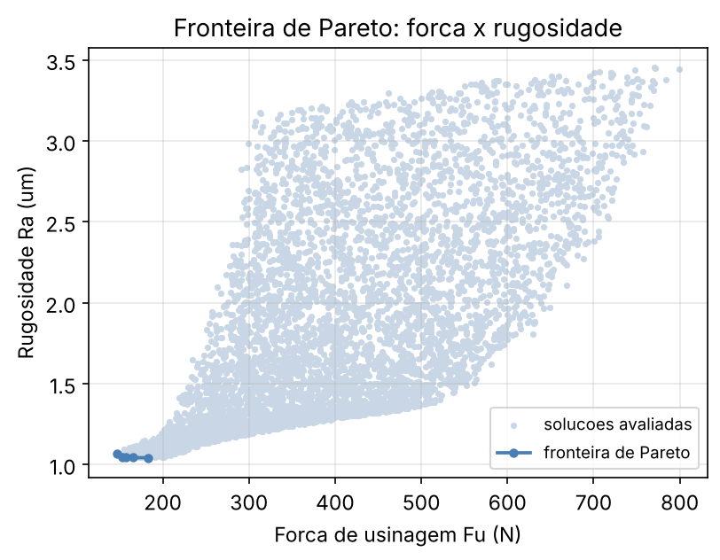

# Modelos globais e otimização multiresposta {#sec-cap10}

## Introdução {#sec-cap10-intro}

Os capítulos anteriores construíram, peça por peça, o edifício do estudo de caso: o projeto experimental (@sec-cap7), os efeitos fatoriais (@sec-cap8) e os modelos de superfície de resposta por liga (@sec-cap9). Este capítulo os une num resultado final e acionável — a **condição de corte ótima** que concilia todas as respostas conflitantes.

Para chegar lá, o capítulo dá três passos. Primeiro, generaliza: em vez de um modelo por liga, constrói **modelos globais** que descrevem a usinabilidade em função das próprias propriedades mecânicas (resistência, alongamento, dureza) somadas às condições de corte — modelos que valem para qualquer liga dentro da faixa estudada. Segundo, **valida** esses modelos numa liga reservada, a 6351-T6, que não participou de sua construção — o teste mais rigoroso de que um modelo capturou a física real. Terceiro, **otimiza**: aplica a otimização multiresposta do Capítulo @sec-cap6 para achar a condição que minimiza força, potência, temperatura e rugosidade simultaneamente.

Este é o ponto onde toda a metodologia do livro (Parte II) e todos os dados do experimento (Parte III) convergem numa recomendação prática. É o retorno sobre o investimento de planejar experimentos.

::: {.callout-note}
## O que este capítulo entrega
A condição de corte recomendada, validada e otimizada — o produto final do estudo. E, mais importante que o número, o método reproduzível para chegar a ele em qualquer problema de usinabilidade.
:::

## Os modelos de regressão global {#sec-cap10-global}

Os modelos por liga do Capítulo @sec-cap9 respondem "qual a usinabilidade desta liga?". Os modelos globais respondem uma pergunta mais poderosa: "qual a usinabilidade de **uma liga com estas propriedades**?". A diferença é decisiva — o modelo global permite prever a usinabilidade de uma liga a partir de sua resistência, alongamento e dureza, sem precisar ensaiá-la.

### A estrutura do modelo global

O modelo global relaciona cada resposta $y_i$ a seis variáveis de entrada: três **propriedades mecânicas** (resistência $R$, alongamento $Ar$, dureza $Hd$) e três **condições de corte** ($v_c$, $a_p$, $f$). É um modelo de segunda ordem na forma matricial (Capítulo @sec-cap5):

$$y_i = \beta_0 + X'b + X'BX$$

onde $X$ reúne as seis variáveis, $b$ é o vetor de coeficientes lineares e $B$ a matriz de coeficientes quadráticos e de interação. Construído sobre 90 observações (cinco ligas × dezoito condições) contra 28 termos candidatos, o modelo mantém apenas os coeficientes significativos (p < 0,05).

### A qualidade dos modelos globais

A Tabela @tbl-global mostra os coeficientes de determinação dos modelos globais para as sete respostas.

| Resposta | $F_u$ | $N_e$ | $T_c$ | $R_a$ | $R_z$ | $R_q$ | $V_b$ |
|:---------|:-----:|:-----:|:-----:|:-----:|:-----:|:-----:|:-----:|
| $R^2$ | 0,966 | 0,985 | 0,909 | 0,901 | 0,910 | 0,903 | 0,879 |
| $R^2$ ajustado | 0,962 | 0,983 | 0,902 | 0,885 | 0,892 | 0,888 | 0,850 |

: Coeficientes de determinação dos modelos de regressão global. {#tbl-global}

Todos os modelos superam $R^2 = 0{,}85$ — bons ajustes, considerando que agora **generalizam através de cinco ligas diferentes**, não apenas uma. É natural que os $R^2$ globais sejam um pouco menores que os por-liga do Capítulo @sec-cap9: o modelo global tem a tarefa mais difícil de valer para toda a faixa de propriedades. Que ainda assim explique 90-98% da variação é o que torna a generalização confiável.

Um achado interessante: as propriedades mecânicas entram nos modelos de forma significativa e via interações. A **dureza ($Hd$)** aparece fortemente na força e na rugosidade; o **alongamento ($Ar$)** e a **resistência ($R$)** modulam várias respostas. A metalurgia do Capítulo @sec-cap2, quantificada, torna-se preditor.

## A validação com a liga 6351-T6 {#sec-cap10-validacao}

Um modelo que se ajusta bem aos dados que o construíram pode estar apenas decorando o ruído. O teste de fogo é prever dados **que ele nunca viu**. Foi para isso que a liga 6351-T6 (R = 336 MPa, Ar = 17%, Hd = 119 HV) foi reservada desde o projeto experimental (@sec-cap7): ela não participou da construção dos modelos, apenas de sua validação.

### O procedimento

A 6351-T6 foi usinada em dezoito condições de corte, medindo-se as respostas reais. Em paralelo, os modelos globais **previram** as respostas para essas mesmas condições. Comparar predito com observado responde: os modelos capturaram a física, ou só ajustaram os dados de treino?

### O veredicto

A comparação foi submetida a análise de variância de fator único, testando se há diferença estatística entre valores preditos e observados. O resultado é o melhor possível: **não há diferença significativa** — os p-níveis ficaram muito acima de 5% (0,75 para força, 0,86 para potência, 0,85 para temperatura, 0,61 para rugosidade). Estatisticamente, as previsões dos modelos são indistinguíveis das medições reais.

Isso valida os modelos de forma robusta: eles preveem a usinabilidade de uma liga que não os construiu, com fidelidade estatística. É a prova de que capturaram a relação física entre propriedades, condições de corte e usinabilidade — não um artefato dos dados de treino.

::: {.callout-important}
## Decisão de projeto
A validação em liga independente (6351-T6) é o que separa um modelo confiável de um exercício de ajuste de curva. Reservar dados para validação "custa" — são ensaios que não entram na construção do modelo. Mas o retorno é a confiança: um modelo validado assim pode ser usado para prever ligas novas dentro da faixa, poupando ensaios futuros. É a mesma lógica treino-validação que hoje estrutura o aprendizado de máquina, aplicada décadas antes em usinabilidade.
:::

## A otimização multiresposta {#sec-cap10-otimizacao}

Com modelos globais validados, chega o momento da otimização. Dos sete modelos, quatro foram selecionados para compor o problema multiobjetivo — **força ($F_u$), potência ($N_e$), temperatura ($T_c$) e rugosidade ($R_a$)** — por sua importância prática no processo. A rugosidade $R_a$ foi escolhida entre os parâmetros de acabamento por ser a mais usada na literatura de usinagem de alumínio.

### O ponto ótimo

Aplicando a otimização multiresposta (Capítulo @sec-cap6), buscou-se a combinação de propriedades e condições de corte que minimiza simultaneamente as quatro respostas. O ponto ótimo encontrado foi:

| Variável | Valor ótimo |
|:---------|:-----------:|
| Resistência $R$ | 323 MPa |
| Alongamento $Ar$ | 44% |
| Dureza $Hd$ | 34,5 HV |
| Velocidade $v_c$ | 126 m/min |
| Profundidade $a_p$ | 2,43 mm |
| Avanço $f$ | 0,19 mm/volta |

: Condição ótima encontrada pela otimização multiresposta. {#tbl-otimo}

Nessa condição, as respostas otimizadas ficam em: força $F_u \approx 723$ N, potência $N_e \approx 1395$ W, temperatura $T_c \approx 344$ °C e rugosidade $R_a \approx 2{,}47$ µm — o melhor compromisso entre as quatro, dado o conflito entre elas.

Note que o ótimo inclui **propriedades da liga** (R, Ar, Hd), não só condições de corte. Isso é o poder do modelo global: ele indica não apenas *como usinar*, mas *que tipo de liga* (em termos de propriedades) usina melhor sob otimização conjunta.

::: {.callout-warning}
## Como ler o ótimo em propriedades
O ponto ótimo combina resistência, alongamento e dureza como se fossem variáveis independentes — mas, como mostra o @sec-cap2, essas propriedades são **fisicamente acopladas**: resistência alta anda com ductilidade baixa e dureza alta. A combinação ótima ($R=323$ MPa, $Ar=44\%$, $Hd=34{,}5$ HV) é, portanto, uma **idealização matemática** do modelo, não uma liga realizável — nenhum material reúne, ao mesmo tempo, essa resistência, essa ductilidade e essa maciez. Ela deve ser lida como a *direção* preferida (ligas mais dúcteis e macias, dentro do envelope real estudado), e a seleção de liga deve respeitar a correlação $R$–$Ar$–$Hd$. Já o ótimo em **condições de corte** ($v_c$, $a_p$, $f$), por não ter esse acoplamento, é diretamente aplicável.
:::

### Reproduzindo a otimização por algoritmo genético

O estudo usou algoritmo genético (Capítulo @sec-cap6) para a busca do ótimo — apropriado dada a superfície multiobjetivo acidentada. O código abaixo reproduz a abordagem, minimizando uma desejabilidade global das quatro respostas.

> **Código demonstrativo.** A versão completa e executável, com os dados reais, está no @sec-apendice-b e no repositório de códigos.

```r

library(GA)          # algoritmo genetico
library(desirability)

# Modelos globais de 2a ordem (coeficientes da Tab. 5.22 da tese)
# Cada funcao preve uma resposta a partir das 6 variaveis codificadas
predizer_Fu <- function(x) { 460.90 + t(x) %*% b_Fu + t(x) %*% B_Fu %*% x }
# (analogo para Ne, Tc, Ra com seus coeficientes)

# Desejabilidades individuais (minimizar as quatro)
d_Fu <- dMin(low = 200, high = 900)
d_Ne <- dMin(low = 500, high = 3000)
d_Tc <- dMin(low = 300, high = 600)
d_Ra <- dMin(low = 0.4, high = 4.0)

# Funcao objetivo: desejabilidade global (a MAXIMIZAR pelo AG)
objetivo <- function(x) {
  fu <- predizer_Fu(x); ne <- predizer_Ne(x)
  tc <- predizer_Tc(x); ra <- predizer_Ra(x)
  D <- dOverall(d_Fu, d_Ne, d_Tc, d_Ra)
  predict(D, data.frame(D1=fu, D2=ne, D3=tc, D4=ra))
}

# Algoritmo genetico: busca o ponto de maxima desejabilidade
resultado <- ga(
  type = "real-valued",
  fitness = objetivo,
  lower = rep(-1.41, 6), upper = rep(1.41, 6),  # limites codificados
  popSize = 100, maxiter = 200, seed = 42
)

summary(resultado)   # ponto otimo e desejabilidade maxima
```

O pacote GA evolui uma população de soluções por 200 gerações, convergindo para a condição de máxima desejabilidade — reproduzindo o ponto ótimo da Tabela @tbl-otimo.

## A fronteira de Pareto como alternativa {#sec-cap10-pareto}

A otimização por desejabilidade entrega **um** ponto — o melhor compromisso segundo os pesos embutidos nas desejabilidades. Mas, como discutido no Capítulo @sec-cap6, há uma alternativa que expõe os *trade-offs* em vez de escondê-los: a fronteira de Pareto, via NSGA-II.

Em vez de dizer "a condição ótima é esta", o NSGA-II entrega o **conjunto de todas as condições eficientes** — aquelas em que não se pode reduzir uma resposta sem aumentar outra. O código abaixo aplica o NSGA-II (via pymoo, Capítulo @sec-cap6) aos modelos globais, mapeando o *trade-off* força × rugosidade.

```python

import numpy as np
from pymoo.core.problem import Problem
from pymoo.algorithms.moo.nsga2 import NSGA2
from pymoo.optimize import minimize

class UsinabilidadeGlobal(Problem):
    def __init__(self):
        super().__init__(n_var=6, n_obj=2,           # 6 variaveis, 2 objetivos
                         xl=np.full(6, -1.41), xu=np.full(6, 1.41))
    def _evaluate(self, X, out, *args, **kwargs):
        # Modelos globais de 2a ordem (coeficientes da Tab. 5.22)
        Fu = np.array([predizer_Fu(x) for x in X])   # minimizar
        Ra = np.array([predizer_Ra(x) for x in X])   # minimizar
        out["F"] = np.column_stack([Fu, Ra])

# NSGA-II: fronteira de Pareto forca x rugosidade
res = minimize(UsinabilidadeGlobal(), NSGA2(pop_size=100),
               ("n_gen", 200), seed=1, verbose=False)

# res.F: cada linha e uma condicao de corte nao-dominada (Fu, Ra)
print("Solucoes na fronteira:", len(res.F))
```

A fronteira resultante mostra, para cada nível de força aceitável, a menor rugosidade atingível — e vice-versa.

{#fig-fronteira-global width=80%} O engenheiro escolhe o ponto conforme a prioridade do momento: se o acabamento é crítico, move-se para a região de baixa rugosidade (aceitando mais força); se a força é o gargalo, para o outro extremo. O ponto de desejabilidade (Tabela @tbl-otimo) é **um** dos pontos dessa fronteira — o que corresponde aos pesos escolhidos.

::: {.callout-tip}
## Na prática
Use as duas abordagens em sequência, como sugerido no Capítulo @sec-cap6: primeiro o NSGA-II para **ver** o *trade-off* força × rugosidade × potência e entender o espaço de compromissos; depois a desejabilidade para **cravar** a condição de operação, uma vez decididas as prioridades. O NSGA-II informa a decisão; a desejabilidade a executa.
:::

## Recomendações operacionais por liga {#sec-cap10-recomendacoes}

Traduzindo todo o estudo em orientação de chão de fábrica, liga a liga:

**1350-O (alumínio puro, recozido).** A mais problemática na usinagem, apesar de mole: cavaco contínuo emaranhado, alto grau de recalque, risco de efeito guarda-chuva. Recomenda-se **avanço mais alto** ($f > 0{,}20$ mm/volta) para melhorar o controle do cavaco, e velocidade elevada para reduzir o recalque. Aceitar que o acabamento será limitado pela ductilidade.

**6082-T4 e 6351-T6 (Al-Mg-Si intermediárias).** Comportamento equilibrado. Avanços moderados a altos dão bom controle de cavaco (forma tubular) sem penalizar demais a rugosidade. São ligas "bem-comportadas" — respondem previsivelmente aos modelos.

**6262-T6 (livre-corte).** A melhor usinabilidade do conjunto, graças ao Bi e Pb. Cavaco fragmentado em arcos soltos com avanços altos. É a liga de escolha quando o controle do cavaco é crítico — a metalurgia resolve o problema na origem.

**7075-T73 e 7075-T6 (Al-Zn-Mg, alta resistência).** Exigem mais força e potência (dimensione a máquina), mas o cavaco é razoavelmente controlável. A 7075-T6, mais dura, é a mais exigente em esforço de corte. Velocidade alta ajuda (amaciamento térmico reduz a força).

**Regra transversal — usine a seco.** Para todas as ligas, a lubri-refrigeração não afetou significativamente as respostas (@sec-cap8). Salvo necessidade específica de controle térmico, a usinagem a seco é recomendável — mais limpa, econômica e sustentável.

## Extensão do estudo: novas ligas {#sec-cap10-extensao}

O poder dos modelos globais é generalizar por propriedades — o que abre caminho para estender o estudo a ligas não ensaiadas. Uma liga nova, caracterizada por sua resistência, alongamento e dureza, pode ter sua usinabilidade **prevista** pelos modelos, sem novos ensaios, desde que suas propriedades caiam dentro da faixa estudada.

Ligas Al-Mg-Si adicionais da mesma família (por exemplo, variantes T6 de composição próxima às já estudadas) são candidatas naturais a essa extensão, tanto para validar os modelos numa faixa mais ampla quanto para investigar como pequenas variações de composição e têmpera deslocam a usinabilidade. Essa é a fronteira de trabalho futuro que os modelos globais habilitam: transformar a caracterização de propriedades — barata — em predição de usinabilidade, poupando a caracterização de usinagem — cara.

::: {.callout-warning}
## Erro comum
Extrapolar os modelos globais para **fora** da faixa de propriedades estudada. Um modelo validado entre R = 60 e 540 MPa não garante predições confiáveis para uma liga de 700 MPa — é extrapolação, terreno onde o modelo não foi testado. A generalização vale dentro do envelope experimental; fora dele, é preciso novos ensaios. Prever é seguro na interpolação, arriscado na extrapolação.
:::

## Síntese do capítulo {#sec-cap10-sintese}

Três ideias devem permanecer:

1. **Os modelos globais generalizam por propriedades.** Preveem a usinabilidade de uma liga a partir de resistência, alongamento e dureza — a metalurgia (@sec-cap2) tornada preditor quantitativo, com $R^2 > 0{,}85$.
2. **A validação em liga independente é o selo de confiança.** A 6351-T6, prevista sem ter construído os modelos, confirmou-os estatisticamente (p > 0,50) — a prova de que capturaram a física.
3. **A otimização entrega a condição recomendada.** Força, potência, temperatura e rugosidade conciliadas num ponto ótimo — e a fronteira de Pareto expõe os *trade-offs* para a decisão final do engenheiro.

Com este capítulo, a Parte III se completa: o estudo de caso percorreu todo o arco, do projeto experimental à condição de corte otimizada e validada. A Parte IV levará essas conclusões ao chão de fábrica e sintetizará as lições do livro.

## Para saber mais {#sec-cap10-saibamais}

::: {.callout-tip}
## Aprofundamento
Os modelos de regressão global seguem a metodologia de @montgomery2005design. A redução da força com a velocidade, por efeitos térmicos e de discordâncias, é discutida em @abukhshim2006heat. A dificuldade de prever o comportamento sob condições severas é destacada por @kilic2007observat. Sobre a escolha do $R_a$ como parâmetro de rugosidade em ligas de alumínio, ver @demir2009, @sreejith2008machinin e @dwivedi2008machinin. Para os algoritmos de otimização, a documentação do pacote GA (R) e do pymoo (Python) complementa o Capítulo @sec-cap6.
:::

## Exercícios resolvidos {#sec-cap10-resolvidos .unnumbered}

### Resolvido 1 — Onde o ótimo se situa na região experimental {.unnumbered}

**Enunciado.** Codifique a condição ótima de corte (Tabela @tbl-otimo: $v_c = 126$ m/min, $a_p = 2{,}43$ mm, $f = 0{,}19$ mm/volta) usando os níveis da Tabela @tbl-niveis-fatorial (Capítulo @sec-cap7). O ótimo está dentro ou fora da região fatorial?

**Solução.** Com $x = (\text{valor} - \text{centro})/\text{semi-amplitude}$ e os centros/semi-amplitudes do Capítulo @sec-cap7:

$$
x_{v_c} = \frac{126 - 400}{200} = -1{,}37, \quad
x_{a_p} = \frac{2{,}43 - 2{,}5}{1{,}5} = -0{,}05, \quad
x_{f} = \frac{0{,}19 - 0{,}275}{0{,}075} = -1{,}13 .
$$

**Interpretação.** A profundidade ótima está praticamente no centro ($-0{,}05$), mas a **velocidade** ($-1{,}37$) e o **avanço** ($-1{,}13$) caem **abaixo** do nível baixo do fatorial ($-1$) — dentro da faixa axial do PCC, que alcança $\pm 1{,}68$. O ótimo mora, portanto, em território que o fatorial $2^k$ puro **não explorou**: foram os pontos axiais do PCC (Capítulo @sec-cap5) que tornaram essa região acessível ao modelo. E, por estar na borda do que foi efetivamente medido, é um ótimo a **confirmar** com ensaios ali, não a extrapolar.

### Resolvido 2 — Pontuando o ótimo pela desejabilidade {.unnumbered}

**Enunciado.** No ótimo, as respostas valem $F_u = 723$ N, $N_e = 1395$ W, $T_c = 344$ °C e $R_a = 2{,}47$ µm. Suponha que a engenharia fixe os limites aceitáveis (valores **ilustrativos**, apenas para este exercício): $F_u \in [600, 900]$, $N_e \in [1000, 5000]$, $T_c \in [300, 600]$, $R_a \in [1{,}5, 3{,}5]$, todos a minimizar, $s = 1$. Calcule a desejabilidade global.

**Solução.** Para cada resposta, $d = \dfrac{U - y}{U - L}$ (fórmula de minimizar, Capítulo @sec-cap6):

$$
d_{F_u} = \frac{900 - 723}{300} = 0{,}59, \quad
d_{N_e} = \frac{5000 - 1395}{4000} = 0{,}90, \quad
d_{T_c} = \frac{600 - 344}{300} = 0{,}85, \quad
d_{R_a} = \frac{3{,}5 - 2{,}47}{2{,}0} = 0{,}52 .
$$

A desejabilidade global é a média geométrica das quatro:

$$
D = \left( 0{,}59 \times 0{,}90 \times 0{,}85 \times 0{,}52 \right)^{1/4} = 0{,}70 .
$$

**Interpretação.** $D \approx 0{,}70$ é um bom compromisso — nenhuma resposta é excelente nem inaceitável, e a geométrica confirma o equilíbrio (nenhum $d$ perto de zero puxando o conjunto para baixo). As respostas menos satisfeitas são a rugosidade (0,52) e a força (0,59), coerente com o fato de que o ótimo as sacrifica um pouco para conciliar todas. **Atenção:** os limites acima são ilustrativos; no estudo real, eles vêm dos requisitos de engenharia (máquina, cliente, custo), e mudá-los desloca o ótimo — a desejabilidade é o método, os limites são a decisão.

## Exercícios propostos {.unnumbered}

1. **Modelo global vs. por liga.** Explique a diferença entre um modelo de regressão por liga (Capítulo @sec-cap9) e um modelo global. Que pergunta cada um responde, e por que o global é mais poderoso?

2. **Qualidade e generalização.** Os $R^2$ globais (0,88-0,99) são um pouco menores que os por-liga (Capítulo @sec-cap9). Explique por que isso é esperado, e por que não invalida os modelos globais.

3. **Validação.** A liga 6351-T6 foi reservada para validação. Por que validar num conjunto independente é mais rigoroso do que avaliar o ajuste nos dados de construção? Relacione com a lógica treino-validação do aprendizado de máquina.

4. **Interpretação do teste.** Na validação, os p-níveis do teste predito-vs-observado ficaram acima de 0,50 (ex.: 0,75 para força). Por que um p-nível **alto** é o resultado desejado aqui, ao contrário da ANOVA de efeitos onde se busca p < 0,05?

5. **Seleção de respostas.** Da otimização participaram $F_u$, $N_e$, $T_c$ e $R_a$ — não $R_z$ nem $R_q$. Explique o critério dessa seleção e por que $R_a$ foi o parâmetro de rugosidade escolhido.

6. **Ponto ótimo.** O ótimo inclui propriedades da liga (R=323, Ar=44%, Hd=34,5) além de condições de corte. Interprete: o que significa otimizar sobre propriedades, e como isso orienta a escolha de liga para uma aplicação?

7. **Desejabilidade vs. Pareto (integrador).** A otimização deu um ponto (desejabilidade); o NSGA-II daria uma fronteira. Descreva como você usaria as duas abordagens em conjunto num projeto real de seleção de condições de corte, e o que cada uma acrescenta.

8. **Extrapolação.** Um engenheiro quer usar os modelos globais para prever a usinabilidade de uma liga com R = 650 MPa. Os modelos foram construídos com R até 540 MPa. Que cuidado ele deve ter, e por quê?

## Gabarito dos exercícios propostos {#sec-cap10-gabarito .unnumbered}

1. **Global vs. por liga.** O modelo por liga responde "como usinar **esta** liga"; o global, "como a usinabilidade varia **através das ligas**, em função das propriedades (R, Ar, Hd) e das condições". O global é mais poderoso por permitir otimizar conjuntamente **qual liga** e **como cortá-la**, e interpolar entre ligas.

2. **Qualidade e generalização.** O $R^2$ global (0,88-0,99), um pouco menor que o por-liga, é **esperado**: o modelo global ajusta mais dados e mais heterogêneos (todas as ligas), logo não "cola" tão perfeitamente a cada uma. Isso não o invalida — reflete captura de tendência geral em vez de memorizar cada liga, e foi confirmado por **validação independente**.

3. **Validação.** Testar numa liga reservada (6351-T6) mede a capacidade de **generalizar** a dados nunca vistos — a lógica treino-validação do aprendizado de máquina. Avaliar só no ajuste premia a memorização (superajuste); a validação independente é o teste honesto.

4. **Interpretação do teste.** No teste predito-vs-observado, a hipótese nula é "predição = observação". Um **p-nível alto** (0,75) indica que **não há diferença detectável** — o modelo acerta. É o oposto da ANOVA de efeitos, onde se busca $p < 0{,}05$ para afirmar que um efeito é real. O que se deseja depende da hipótese testada.

5. **Seleção de respostas.** Entraram $F_u$, $N_e$, $T_c$ e $R_a$ por sua **relevância prática** (esforço, energia, calor, acabamento). $R_a$ foi o parâmetro de rugosidade escolhido por ser o **mais usado na literatura** de usinagem de alumínio; $R_z$ e $R_q$ são correlacionados e redundantes para a otimização.

6. **Ponto ótimo.** Otimizar sobre R, Ar, Hd indica **que tipo de liga** (em propriedades) usina melhor sob o compromisso buscado, orientando a **seleção de material**. Mas as propriedades são **acopladas** (resistência alta ↔ ductilidade baixa): o ótimo é uma **direção preferida**, não uma liga realizável; a escolha final respeita a correlação física.

7. **Desejabilidade vs. Pareto.** Use o **NSGA-II** primeiro para **mapear a fronteira** e enxergar os trade-offs; depois a **desejabilidade** para **cravar um ponto**, dados os pesos e limites de engenharia. Pareto dá o mapa; desejabilidade dá o destino.

8. **Extrapolação.** Prever para $R = 650$ MPa com modelos construídos até 540 MPa é **extrapolação**: fora do envelope dos dados, o modelo de segunda ordem pode divergir (a curvatura ajustada não vale além da faixa medida). A previsão é não confiável; o correto é **coletar dados nessa faixa** e reajustar, não confiar na extrapolação.
