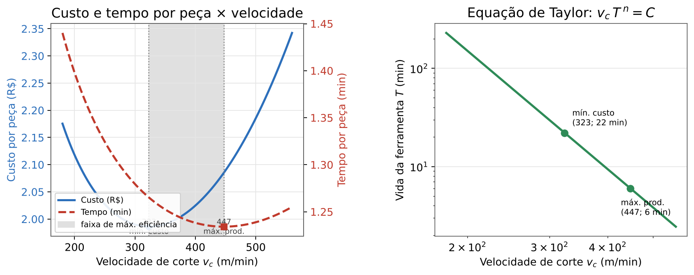

# Otimização econômica da usinagem {#sec-cap-econ}

*Custo, produtividade e vida de ferramenta*

> Até aqui a otimização buscou o melhor desempenho técnico — menor força, menor rugosidade, menor vibração. Mas o chão de fábrica cobra uma pergunta adicional: quanto custa, e quão rápido? Este capítulo traz a economia da usinagem para dentro do DOE. Apresenta a equação de Taylor da vida de ferramenta, o modelo de custo por peça, a taxa de produção, e deduz as duas velocidades notáveis — a de mínimo custo e a de máxima produção — e o intervalo de máxima eficiência entre elas. Mostra, por fim, como acrescentar o objetivo econômico à otimização multiresposta, para que a condição recomendada seja ótima não só na bancada, mas na planilha de custos.

## Introdução {#sec-cap-econ-intro}

O estudo de caso otimizou a usinabilidade — força, potência, rugosidade — e chegou a condições de corte tecnicamente excelentes (Capítulo @sec-cap10). Resta, porém, a pergunta que o gerente de produção sempre faz: **essa condição é a mais econômica?** Nem sempre. A velocidade que minimiza a rugosidade pode desgastar a ferramenta depressa demais; a que maximiza a vida da ferramenta pode produzir devagar demais.

A economia da usinagem é uma disciplina clássica, anterior ao DOE moderno, e resolve exatamente esse conflito. Ela parte de uma constatação simples: **aumentar a velocidade de corte acelera a produção, mas encurta a vida da ferramenta** — e troca de ferramenta custa tempo e dinheiro. Existe, portanto, uma velocidade ótima — na verdade, duas: uma que minimiza o custo por peça, outra que maximiza a produção. Este capítulo deduz ambas e mostra como integrá-las ao DOE.

::: {.callout-note}
## Onde este capítulo se conecta
A otimização multiresposta do Capítulo @sec-cap10 conciliou respostas técnicas. Aqui acrescentamos duas respostas de natureza econômica — **custo por peça** e **tempo de produção** — que podem entrar na mesma função de desejabilidade (@sec-cap6), tornando o ótimo completo: técnico **e** econômico. Os fundamentos de torneamento (Capítulo @sec-cap3) sustentam os modelos de tempo de corte usados aqui.
:::

## A vida de ferramenta: a equação de Taylor {#sec-cap-econ-taylor}

A base de toda a economia da usinagem é a relação entre velocidade de corte e vida de ferramenta, formulada por F. W. Taylor em 1907:

$$
v_c \, T^{\,n} = C,
$$ {#eq-taylor}

onde $v_c$ é a velocidade de corte (m/min), $T$ a vida da ferramenta (min), e $n$ e $C$ constantes do par ferramenta-material, obtidas por um ensaio de vida de ferramenta. O expoente $n$ é tipicamente $0{,}1$ a $0{,}3$ para metal duro e $C$ é a velocidade que produz vida de 1 minuto. Isolando a vida:

$$
T = \left( \frac{C}{v_c} \right)^{1/n}.
$$

A equação captura o compromisso central: como $n < 1$, um pequeno aumento de $v_c$ **reduz muito** a vida $T$. Dobrar a velocidade, com $n = 0{,}25$, divide a vida por $2^{4} = 16$. É essa sensibilidade que torna a escolha da velocidade uma decisão econômica, não apenas técnica.

### A equação de Taylor ampliada {#sec-cap-econ-taylor-ampliada}

A forma simples @eq-taylor fixa avanço e profundidade — mas ambos afetam a vida da ferramenta. A **equação de Taylor ampliada** inclui os três parâmetros de corte:

$$
v_c\, T^{\,n} f^{\,a} a_p^{\,b} = C',
\qquad\text{ou}\qquad
T = \left( \frac{C'}{v_c\, f^{\,a}\, a_p^{\,b}} \right)^{1/n}.
$$ {#eq-taylor-ampliada}

Os expoentes obedecem tipicamente a $n < b < a$ (para metal duro, ordens de grandeza $n \approx 0{,}25$, $a \approx 0{,}6$, $b \approx 0{,}25$): **a velocidade é o que mais encurta a vida, seguida do avanço e, por último, da profundidade**. A física é a do Capítulo @sec-cap3 — velocidade e avanço elevam a temperatura e a solicitação do gume mais do que a profundidade, que apenas alonga o comprimento de contato.

Um exemplo torna a hierarquia concreta. Calibrando $C'$ para coincidir com a forma simples numa condição de referência ($v_c = 300$, $f = 0{,}20$, $a_p = 1{,}5$, vida $\approx 30$ min), a vida na condição ótima do estudo de caso ($v_c = 126$, $f = 0{,}19$, $a_p = 2{,}43$) sobe para cerca de **665 min** — a velocidade baixa domina. A partir daí, **dobrar o avanço** (para $0{,}38$) derruba a vida para $\approx 126$ min, enquanto **dobrar a profundidade** (para $4{,}86$) a reduz só a $\approx 333$ min: o avanço custa muito mais vida que a profundidade, exatamente o que $a > b$ prevê.

::: {.callout-note}
## Fundamentação matemática: o ótimo econômico com três fatores
Minimizando o custo @eq-custo sob a Taylor ampliada, a **vida de mínimo custo não muda** — $T_{\text{mín. custo}} = (\tfrac{1}{n}-1)(t_d + C_e/C_m)$ depende só de $n$ e dos custos, não de $f$ nem $a_p$. Muda a **velocidade** que a realiza, $v_c = C'/(T^{\,n} f^{\,a} a_p^{\,b})$, e o custo total **sempre cai** com $f$ e $a_p$ maiores (menos tempo de usinagem por peça). Logo, o ótimo econômico empurra avanço e profundidade **até o limite** de outras restrições — a rugosidade limita $f$, a força e a potência limitam $a_p$ e $f$ — e só então aplica a velocidade de mínimo custo. Otimizar os três resume-se a: maximizar $f$ e $a_p$ dentro das restrições, depois escolher a velocidade econômica.
:::

## O custo por peça {#sec-cap-econ-custo}

O custo de usinar uma peça, no modelo clássico de Gilbert, soma quatro parcelas:

$$
C_p = \underbrace{C_m\, t_m}_{\text{usinagem}} + \underbrace{C_m\, t_h}_{\text{manuseio}} + \underbrace{(C_m\, t_d + C_e)\,\dfrac{t_m}{T}}_{\text{troca e ferramenta}},
$$ {#eq-custo}

onde $C_m$ é o custo de máquina mais operador (R\$/min), $t_m$ o tempo de usinagem por peça, $t_h$ o tempo de manuseio (carga/descarga), $t_d$ o tempo de troca de aresta, $C_e$ o custo por aresta de corte, e $T$ a vida da ferramenta. A razão $t_m/T$ é a **fração de ferramenta consumida por peça** — quantas peças uma aresta rende.

O tempo de usinagem, para um passe de torneamento de um cilindro de diâmetro $D$ e comprimento $L$, é:

$$
t_m = \frac{\pi\, D\, L}{1000\, v_c\, f},
$$

com $D$ e $L$ em mm, $v_c$ em m/min e $f$ em mm/volta. À medida que $v_c$ cresce, $t_m$ cai (bom: usina mais rápido), mas $T$ cai mais rápido ainda (ruim: troca ferramenta toda hora). O custo total tem, portanto, um **mínimo**.

## A taxa de produção {#sec-cap-econ-producao}

O tempo total para produzir uma peça soma usinagem, manuseio e a parcela de troca:

$$
t_p = t_m + t_h + t_d\,\frac{t_m}{T}.
$$ {#eq-tempo}

A **taxa de produção** é $1/t_p$. Também ela tem um ótimo: velocidades baixas usinam devagar; velocidades altas gastam tempo demais trocando ferramenta. Entre os dois extremos, um máximo de produção.

## As duas velocidades notáveis {#sec-cap-econ-velocidades}

Minimizando @eq-custo e @eq-tempo em relação a $v_c$ (via Taylor), obtêm-se as **vidas de ferramenta ótimas** — e delas, por @eq-taylor, as velocidades:

$$
T_{\text{mín. custo}} = \left( \frac{1}{n} - 1 \right)\!\left( t_d + \frac{C_e}{C_m} \right),
\qquad
T_{\text{máx. prod.}} = \left( \frac{1}{n} - 1 \right) t_d .
$$ {#eq-vidas}

Duas leituras importantes. Primeiro, a **vida de mínimo custo é sempre maior** que a de máxima produção (o termo $C_e/C_m$ a aumenta) — logo, a **velocidade de mínimo custo é sempre menor** que a de máxima produção. Segundo, nenhuma das duas depende do avanço ou da geometria da peça: dependem só de Taylor ($n$) e dos custos/tempos. O avanço e a profundidade entram no **valor** do custo, não na velocidade ótima (na forma simples de Taylor).

### O intervalo de máxima eficiência {#sec-cap-econ-eficiencia}

Entre a velocidade de mínimo custo e a de máxima produção estende-se o **intervalo de máxima eficiência** (IME): nenhuma velocidade fora dele faz sentido econômico. Abaixo do mínimo custo, perde-se dinheiro **e** produção; acima da máxima produção, idem. Dentro do IME, a escolha é um balanço gerencial — mais perto do mínimo custo quando a prioridade é margem, mais perto da máxima produção quando há demanda a atender e a máquina é gargalo.

::: {.callout-important}
## Decisão de projeto
O IME é a faixa onde a decisão deixa de ser técnica e passa a ser estratégica. O DOE entrega os modelos; a economia entrega os limites; o gestor escolhe o ponto dentro deles conforme a conjuntura — carteira de pedidos, custo de capital, criticidade do prazo. Recomendar uma única velocidade sem apresentar o IME é esconder do decisor a margem de manobra que ele tem.
:::

## Custo de ferramenta e vida sob desgaste {#sec-cap-econ-desgaste}

A vida $T$ que alimenta Taylor e o custo não é um número abstrato: é **medida por um critério de desgaste**. Convenciona-se que a ferramenta "morreu" quando o desgaste de flanco atinge um limite — tipicamente $VB = 0{,}3$ mm no acabamento (ou $VB = 0{,}6$ mm no desbaste). A vida é o tempo de corte até cruzar esse limite; a equação de Taylor nada mais é que o ajuste de como esse tempo cai com a velocidade.

No alumínio, o mecanismo que governa esse desgaste é peculiar e já foi caracterizado no estudo de caso (Capítulo @sec-cap9): a **adesão** e a **aresta postiça de corte** (BUE). O alumínio, dúctil e de baixo ponto de fusão, solda-se ao gume; os destacamentos periódicos da aresta postiça arrancam material da ferramenta, acelerando o desgaste e deteriorando o acabamento. Foi por isso que a geometria polida e afiada da ferramenta do estudo foi escolhida — para minimizar justamente essa adesão. A consequência econômica é direta: **a estratégia que controla a aresta postiça prolonga a vida $T$ e, por @eq-custo, baixa o custo por peça** — ligando o estudo de desgaste do Capítulo @sec-cap9 ao modelo de custo deste capítulo.

O custo por aresta, $C_e$, fecha a conta. Uma pastilha intercambiável oferece várias arestas (uma pastilha quadrada, por exemplo, quatro a oito gumes), então $C_e$ é o preço da pastilha dividido pelo número de arestas aproveitáveis, mais o rateio do porta-ferramentas. Esse $C_e$, a vida $T$ medida pelo critério de $VB$, e a razão $t_m/T$ são o que traduz o desgaste físico em reais por peça — e o que torna o estudo de desgaste parte integrante da avaliação econômica, não um apêndice técnico.

::: {.callout-tip}
## Na prática
Antes de aplicar Taylor, faça o ensaio de vida de ferramenta que fornece $n$ e $C$: usine em duas ou três velocidades, registre o tempo até $VB = 0{,}3$ mm em cada uma e ajuste a reta de $\log T$ contra $\log v_c$ — a inclinação vale $-1/n$ e o intercepto dá $C$. Sem esse ensaio, os parâmetros de Taylor são chute; com ele, toda a economia deste capítulo ganha base experimental, como o DOE deu base aos modelos de usinabilidade.
:::

## Exemplo resolvido: do ótimo técnico ao ótimo econômico {#sec-cap-econ-exemplo}

Tomemos um cenário de torneamento de alumínio com metal duro, com parâmetros ilustrativos (as constantes de Taylor viriam de um ensaio de vida de ferramenta; as demais, da contabilidade da planta):

| Parâmetro | Símbolo | Valor |
|:---|:---:|:---:|
| Expoente de Taylor | $n$ | 0,25 |
| Constante de Taylor | $C$ | 700 m/min |
| Diâmetro / comprimento | $D$ / $L$ | 50 / 100 mm |
| Avanço | $f$ | 0,20 mm/volta |
| Custo máquina + operador | $C_m$ | R\$ 1,50/min |
| Tempo de manuseio | $t_h$ | 1,00 min |
| Tempo de troca de aresta | $t_d$ | 2,00 min |
| Custo por aresta | $C_e$ | R\$ 8,00 |

: Parâmetros ilustrativos do exemplo econômico. {#tbl-econ-param}

Aplicando @eq-vidas e depois @eq-taylor:

$$
T_{\text{mín. custo}} = (4-1)\left(2 + \tfrac{8}{1{,}5}\right) = 3 \times 7{,}33 = 22{,}0 \text{ min}
\;\Rightarrow\; v_{\text{mín. custo}} = \frac{700}{22{,}0^{\,0{,}25}} \approx 323 \text{ m/min},
$$

$$
T_{\text{máx. prod.}} = (4-1)(2) = 6{,}0 \text{ min}
\;\Rightarrow\; v_{\text{máx. prod.}} = \frac{700}{6{,}0^{\,0{,}25}} \approx 447 \text{ m/min}.
$$

O **intervalo de máxima eficiência** vai, portanto, de **323 a 447 m/min**. A Tabela @tbl-econ-result compara os dois pontos.

| Critério | Mínimo custo | Máxima produção |
|:---|:---:|:---:|
| Velocidade $v_c$ (m/min) | 323 | 447 |
| Vida da ferramenta $T$ (min) | 22,0 | 6,0 |
| Custo por peça (R\$) | **1,99** | 2,09 |
| Tempo por peça (min) | 1,27 | **1,23** |

: Comparação dos dois pontos notáveis. {#tbl-econ-result}

A leitura é instrutiva: ir do mínimo custo à máxima produção **encurta o tempo por peça em apenas 3%** (1,27 → 1,23 min), mas **encarece a peça em 5%** (R\$ 1,99 → R\$ 2,09) e **triplica o consumo de ferramenta** (vida de 22 para 6 min). Produzir no limite da máxima produção só se justifica quando a máquina é gargalo e cada minuto de produção vale mais que o custo extra de ferramenta.

{#fig-econ-curvas width=100%}

### O trade-off custo × rugosidade {#sec-cap-econ-pareto}

E o avanço? Ele não muda a velocidade de mínimo custo, mas governa um trade-off próprio: **avanço maior barateia a peça** (usina mais rápido) **e piora a rugosidade** (@sec-cap9). Com a rugosidade teórica $R_a \approx f^2/(32\, r_\varepsilon)$ (raio de ponta $r_\varepsilon = 0{,}8$ mm), cada avanço, operado em sua velocidade de mínimo custo, dá o par da Tabela @tbl-econ-pareto.

| Avanço $f$ (mm/volta) | $R_a$ (µm) | Custo (R\$/peça) |
|:---:|:---:|:---:|
| 0,10 | 0,39 | 2,47 |
| 0,15 | 0,88 | 2,15 |
| 0,20 | 1,56 | 1,99 |
| 0,25 | 2,44 | 1,89 |
| 0,30 | 3,52 | 1,82 |
| 0,40 | 6,25 | 1,74 |

: Fronteira custo × rugosidade variando o avanço. {#tbl-econ-pareto}

É uma **fronteira de Pareto**: não há avanço que melhore as duas respostas ao mesmo tempo. Se a peça exige $R_a \le 1{,}6$ µm, o avanço fica limitado a $\approx 0{,}20$ mm/volta, e o custo mínimo viável é R\$ 1,99. Afrouxar a rugosidade para 3,5 µm permitiria baixar o custo a R\$ 1,82 — a decisão depende da especificação do produto. É o mesmo raciocínio de Pareto do Capítulo @sec-cap10, agora com uma resposta técnica e uma econômica.

### Levando o custo ao multiresposta {#sec-cap-econ-multi}

Para integrar a economia ao DOE, basta tratar **custo por peça** e **tempo de produção** como respostas adicionais na desejabilidade (@sec-cap6): define-se para cada uma uma função do tipo "menor é melhor" e combina-se com as respostas técnicas na média geométrica. O ótimo resultante concilia, num só número, acabamento, força, custo e produtividade — e o peso relativo de cada objetivo (pelo expoente da desejabilidade) traduz a prioridade da planta. Assim, o ótimo recomendado ao fim do estudo (Capítulo @sec-cap10) pode ser reponderado para refletir não só o que a peça exige, mas o que ela custa.

## Estudo de caso: a economia do ótimo do Capítulo @sec-cap10 {#sec-cap-econ-estudocaso}

Até aqui a economia foi exposta sobre um cenário didático. Apliquemo-la ao **ótimo real** do estudo de caso. A otimização multiresposta do Capítulo @sec-cap10 recomendou, para a usinabilidade, a condição $v_c = 126$ m/min, $a_p = 2{,}43$ mm, $f = 0{,}19$ mm/volta (Tabela @tbl-otimo), que minimiza força, potência, temperatura e rugosidade. **Essa condição é economicamente boa?**

Para responder, aplicamos o modelo de custo (@eq-custo) com os parâmetros ilustrativos da Tabela @tbl-econ-param, mantendo o avanço do ótimo ($f = 0{,}19$) e variando apenas a velocidade. A Tabela @tbl-econ-caso compara o ótimo técnico com as velocidades de mínimo custo e de máxima produção.

| Condição | $v_c$ (m/min) | Vida $T$ (min) | Custo (R\$/peça) | Tempo (min/peça) |
|:---|:---:|:---:|:---:|:---:|
| **Ótimo técnico** (Cap. @sec-cap10) | 126 | 953 | 2,49 | 1,66 |
| Mínimo custo | 323 | 22 | **2,01** | 1,28 |
| Máxima produção | 447 | 6 | 2,12 | **1,25** |

: Economia da condição ótima do estudo de caso, comparada às velocidades econômicas. {#tbl-econ-caso}

O veredito é instrutivo. O ótimo técnico usina **devagar** ($v_c = 126$ m/min, a menor da região estudada): isso minimiza força, potência e temperatura e, de quebra, faz a ferramenta durar quase indefinidamente (953 min). Mas a lentidão **custa**: comparado à velocidade de mínimo custo, o ótimo técnico sai **24% mais caro** e **30% mais lento** por peça — não por desgaste de ferramenta (mínimo aqui), mas porque cada peça ocupa a máquina por muito mais tempo.

Eis o conflito em sua forma mais nítida: a condição que a engenharia de qualidade prefere (menor força e rugosidade) **não** é a que a engenharia de produção prefere (menor custo e maior vazão). Subir a velocidade de 126 para 323 m/min cortaria 24% do custo e 30% do tempo — ao preço de mais força, potência, temperatura e rugosidade, justamente as respostas que o ótimo técnico protegia. Não há resposta única: há um **trade-off** que só a direção da empresa resolve, pesando margem contra qualidade. O papel do DOE somado à economia deste capítulo é tornar esse trade-off **explícito e quantificado** — e é o que a integração do custo à desejabilidade (@sec-cap-econ-multi) permite, trazendo a velocidade econômica para dentro dos objetivos do ótimo.

::: {.callout-important}
## Decisão de projeto
O ótimo do Capítulo @sec-cap10 é um ótimo **técnico** — não enxergou custo nem produtividade. Apresentá-lo à produção sem a análise econômica ao lado esconde que ele sacrifica 24% de custo e 30% de vazão. A recomendação madura leva as duas tabelas juntas: a condição de menor força/rugosidade **e** a de menor custo, com o intervalo entre elas como espaço de decisão. Os parâmetros de Taylor e de custo aqui são ilustrativos; com um ensaio de vida de ferramenta (@sec-cap-econ-desgaste) e os custos reais da planta, a mesma análise entrega a recomendação econômica definitiva.
:::

## Código: as contas da economia {#sec-cap-econ-codigo}

```python
import numpy as np
from scipy.optimize import minimize_scalar

n, C = 0.25, 700.0          # Taylor
D, L, f = 50.0, 100.0, 0.20 # geometria e avanco
Cm, th, td, Ce = 1.50, 1.0, 2.0, 8.0

T  = lambda v: (C/v)**(1/n)                 # vida de Taylor
tm = lambda v: np.pi*D*L/(1000*v*f)         # tempo de usinagem
custo = lambda v: Cm*tm(v) + Cm*th + (Cm*td + Ce)*(tm(v)/T(v))
tempo = lambda v: tm(v) + th + td*(tm(v)/T(v))

# otimos analiticos (vida -> velocidade por Taylor)
T_mc = (1/n - 1)*(td + Ce/Cm);  v_mc = C/T_mc**n
T_mp = (1/n - 1)*td;            v_mp = C/T_mp**n
print(f"min custo: v={v_mc:.0f} m/min (T={T_mc:.0f} min)")
print(f"max prod : v={v_mp:.0f} m/min (T={T_mp:.0f} min)")

# confirmacao numerica
print(minimize_scalar(custo, bounds=(50,600), method='bounded').x)
print(minimize_scalar(tempo, bounds=(50,600), method='bounded').x)
```

```r
# R: curva de custo por peca em funcao da velocidade
n <- 0.25; C <- 700; D <- 50; L <- 100; f <- 0.20
Cm <- 1.5; th <- 1; td <- 2; Ce <- 8

Tvida <- function(v) (C/v)^(1/n)
tm    <- function(v) pi*D*L/(1000*v*f)
custo <- function(v) Cm*tm(v) + Cm*th + (Cm*td + Ce)*(tm(v)/Tvida(v))

v <- seq(150, 600, by = 1)
plot(v, custo(v), type = "l", xlab = "vc (m/min)", ylab = "custo/peca (R$)")
abline(v = C/((1/n-1)*(td+Ce/Cm))^n, lty = 2)  # velocidade de minimo custo
```

## Síntese do capítulo {#sec-cap-econ-sintese}

| Tema | Ideia-chave |
|:---|:---|
| Equação de Taylor | $v_c T^n = C$: velocidade alta encurta muito a vida ($n<1$) |
| Taylor ampliada | $v_c T^n f^a a_p^b = C'$: $v_c$ e $f$ encurtam a vida mais que $a_p$ |
| Custo por peça | Usinagem + manuseio + troca/ferramenta; tem mínimo |
| Taxa de produção | Tem máximo; não coincide com o mínimo custo |
| Duas velocidades | $v_{\text{mín. custo}} < v_{\text{máx. prod.}}$, sempre |
| Intervalo de eficiência | Faixa entre as duas; a escolha ali é gerencial |
| Vida sob desgaste | $T$ medida por critério $VB$; adesão/BUE a governa no alumínio |
| Custo no multiresposta | Entra na desejabilidade como resposta "menor é melhor" |
| Ótimo técnico × econômico | O ótimo do estudo é lento: +24% custo e +30% tempo vs. mínimo custo |

: Síntese da otimização econômica. {#tbl-sintese-econ}

Três ideias devem permanecer:

1. **O ótimo técnico não é o ótimo econômico.** A velocidade que minimiza a rugosidade raramente é a que minimiza o custo; escolher sem contar o custo da ferramenta é escolher no escuro.
2. **Existem duas velocidades ótimas, não uma.** A de mínimo custo e a de máxima produção delimitam o intervalo de máxima eficiência — e revelam ao gestor a margem de manobra.
3. **A economia cabe no DOE.** Custo e produtividade são respostas como as demais; integrá-las à desejabilidade completa a otimização, unindo a bancada à planilha.

O próximo capítulo acrescenta a esse quadro uma terceira dimensão, hoje incontornável: a **sustentabilidade** — energia, fluidos e pegada ambiental da usinagem.

## Para saber mais {#sec-cap-econ-saibamais}

::: {.callout-tip}
## Aprofundamento
A economia da usinagem e a dedução das velocidades de mínimo custo e máxima produção são tratadas em profundidade em @groover2010fundamentals e nos textos clássicos de processos de fabricação. A equação de Taylor e suas extensões, bem como os ensaios de vida de ferramenta que fornecem $n$ e $C$, aparecem em @machado2009teoria. Para a integração de objetivos econômicos à otimização multiresposta, ver @montgomery2005design (Capítulo @sec-cap6).
:::

## Exercícios resolvidos {#sec-cap-econ-resolvidos .unnumbered}

### Resolvido 1 — Velocidade de mínimo custo {.unnumbered}

**Enunciado.** Com $n = 0{,}25$, $C = 700$ m/min, $t_d = 2$ min, $C_e = \text{R\$}\,8$ e $C_m = \text{R\$}\,1{,}50$/min, calcule a velocidade de mínimo custo.

**Solução.** Pela vida ótima de @eq-vidas: $T_{\text{mín. custo}} = (1/0{,}25 - 1)(2 + 8/1{,}5) = 3 \times (2 + 5{,}33) = 3 \times 7{,}33 = 22{,}0$ min. Por Taylor: $v = 700 / 22{,}0^{\,0{,}25} = 700/2{,}166 \approx 323$ m/min.

**Interpretação.** A ferramenta deve durar 22 min para minimizar o custo; operar nessa vida fixa a velocidade em 323 m/min. Velocidades maiores produzem mais rápido, mas o custo de ferramenta cresce mais do que a economia de tempo.

### Resolvido 2 — Mínimo custo × máxima produção {.unnumbered}

**Enunciado.** Com os mesmos dados, calcule a velocidade de máxima produção e compare com a de mínimo custo. Por que diferem?

**Solução.** $T_{\text{máx. prod.}} = (1/0{,}25 - 1)(2) = 3 \times 2 = 6{,}0$ min; $v = 700/6{,}0^{\,0{,}25} = 700/1{,}565 \approx 447$ m/min. A de mínimo custo era 323 m/min — **menor**.

**Interpretação.** Diferem porque a máxima produção ignora o custo da ferramenta ($C_e$): só quer encurtar o tempo, aceitando trocas frequentes (vida de 6 min). O mínimo custo inclui $C_e/C_m$ na vida ótima, alongando-a para 22 min. O intervalo 323–447 m/min é o de máxima eficiência.

### Resolvido 3 — Trade-off custo × rugosidade {.unnumbered}

**Enunciado.** Pela Tabela @tbl-econ-pareto, uma peça exige $R_a \le 2{,}0$ µm. Qual o maior avanço admissível e o custo correspondente? E se a tolerância subir para $R_a \le 3{,}0$ µm?

**Solução.** Para $R_a \le 2{,}0$ µm, o avanço vai até $\approx 0{,}20$ mm/volta ($R_a = 1{,}56$ µm; o próximo, 0,25, já dá 2,44 µm), com custo R\$ 1,99/peça. Afrouxando para $R_a \le 3{,}0$ µm, cabe $f = 0{,}25$ mm/volta ($R_a = 2{,}44$ µm), baixando o custo a R\$ 1,89/peça.

**Interpretação.** Cada décimo de micrômetro de rugosidade tolerado "compra" redução de custo. A fronteira de Pareto transforma a especificação de acabamento numa decisão de custo explícita — exatamente a informação que o projetista do produto precisa para não superespecificar.

## Exercícios propostos {.unnumbered}

1. **Taylor.** Com $n = 0{,}2$ e $C = 600$ m/min, qual a vida da ferramenta a $v_c = 300$ m/min? E a $v_c = 400$ m/min? Comente a sensibilidade.

2. **Tempo de usinagem.** Calcule $t_m$ para $D = 60$ mm, $L = 150$ mm, $v_c = 300$ m/min e $f = 0{,}25$ mm/volta.

3. **Velocidade de mínimo custo.** Refaça o Resolvido 1 com $C_e = \text{R\$}\,20$ (ferramenta mais cara). A velocidade de mínimo custo sobe ou desce? Explique fisicamente.

4. **Velocidade de máxima produção.** Com $n = 0{,}25$, $C = 700$ e $t_d = 3$ min, calcule a velocidade de máxima produção. Como ela muda se a troca de aresta for mais lenta?

5. **Intervalo de eficiência.** Explique, em até cinco linhas, por que não há sentido econômico em operar abaixo da velocidade de mínimo custo nem acima da de máxima produção.

6. **Custo por peça.** Usando @eq-custo com os dados da Tabela @tbl-econ-param, calcule o custo por peça a $v_c = 250$ m/min e compare com o de mínimo custo (R\$ 1,99). Confirma que 323 m/min é melhor?

7. **Integração (Pareto).** Pela Tabela @tbl-econ-pareto, um cliente aceita pagar R\$ 0,15 a mais por peça para ganhar acabamento. Partindo de $f = 0{,}30$ (R\$ 1,82), até que avanço vale a pena reduzir, e qual $R_a$ se obtém?

8. **Multiresposta.** Descreva como você acrescentaria "custo por peça" à otimização por desejabilidade do Capítulo @sec-cap10. Que tipo de função de desejabilidade (maior/menor/nominal é melhor) o custo exige?

## Gabarito dos exercícios propostos {#sec-cap-econ-gabarito .unnumbered}

1. **Taylor.** $T = (C/v)^{1/n}$. A $300$: $(600/300)^{5} = 2^5 = 32$ min. A $400$: $(600/400)^{5} = 1{,}5^5 \approx 7{,}6$ min. Aumentar a velocidade em 1/3 **reduz a vida a menos de um quarto** — a alta sensibilidade que $n$ pequeno impõe.

2. **Tempo de usinagem.** $t_m = \pi \cdot 60 \cdot 150 / (1000 \cdot 300 \cdot 0{,}25) = 28\,274 / 75\,000 \approx 0{,}377$ min ($\approx 23$ s).

3. **Ferramenta mais cara.** $T_{\text{mín. custo}} = 3(2 + 20/1{,}5) = 3 \times 15{,}33 = 46{,}0$ min; $v = 700/46^{\,0{,}25} \approx 269$ m/min. A velocidade de mínimo custo **desce** (de 323 para 269): ferramenta cara pede vida mais longa, logo velocidade menor, para diluir o custo de aresta por mais peças.

4. **Máxima produção.** $T_{\text{máx. prod.}} = (4-1)(3) = 9$ min; $v = 700/9^{\,0{,}25} \approx 404$ m/min. Troca mais lenta ($t_d$ maior) **reduz** a velocidade de máxima produção: se trocar custa mais tempo, compensa durar mais e correr menos.

5. **Intervalo de eficiência.** Abaixo do mínimo custo, aumentar a velocidade reduz **ao mesmo tempo** o custo e o tempo por peça — logo, estar abaixo é desperdício nas duas métricas. Acima da máxima produção, reduzir a velocidade reduz o custo **e** aumenta a produção. Só entre os dois pontos qualquer movimento troca uma métrica pela outra; fora deles, há pura perda.

6. **Custo a 250 m/min.** $t_m = \pi\cdot50\cdot100/(1000\cdot250\cdot0{,}2) = 15\,708/50\,000 = 0{,}314$ min; $T = (700/250)^4 = 2{,}8^4 \approx 61{,}5$ min. $C_p = 1{,}5(0{,}314) + 1{,}5(1) + (1{,}5\cdot2 + 8)(0{,}314/61{,}5) = 0{,}471 + 1{,}5 + 11\cdot0{,}00511 = 0{,}471 + 1{,}5 + 0{,}056 \approx \text{R\$}\,2{,}03$. É **maior** que R\$ 1,99 — confirma que 323 m/min (mínimo custo) é melhor que 250.

7. **Integração (Pareto).** De R\$ 1,82 ($f=0{,}30$), aceitar +R\$ 0,15 chega a R\$ 1,97 — ainda abaixo de R\$ 1,99 ($f=0{,}20$) e acima de R\$ 1,89 ($f=0{,}25$). Logo vale reduzir até $f = 0{,}25$ mm/volta (custo R\$ 1,89, dentro do orçamento), obtendo $R_a \approx 2{,}44$ µm — melhor acabamento que os 3,52 µm de $f=0{,}30$.

8. **Multiresposta.** Calcula-se o custo por peça em cada ponto experimental (via @eq-custo) e define-se uma desejabilidade individual do tipo **"menor é melhor"** para ele — $d = 1$ no custo mais baixo aceitável, $d = 0$ no teto de custo tolerável. Combina-se essa desejabilidade com as das respostas técnicas na média geométrica (@sec-cap6); o expoente atribuído ao custo fixa sua prioridade relativa. O ótimo global passa a minimizar custo **e** respeitar os alvos técnicos simultaneamente.
